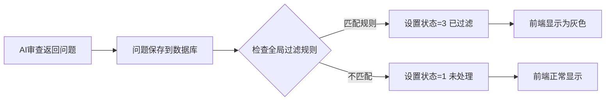

# 全局过滤规则使用说明

## 🎯 功能概述

AI代码审查的**全局自动过滤系统**，所有任务共享同一套过滤规则，AI返回问题后自动过滤，无需前端操作。

### 特点
- ✅ **后端JSON配置**：规则存储在配置文件中，易于管理
- ✅ **全局自动应用**：所有任务自动使用，无需手动配置
- ✅ **实时生效**：AI返回问题时立即过滤
- ✅ **AND/OR逻辑**：支持复杂过滤条件

## 📁 配置文件位置

```
backend/app/codeReview/ConfigurationItem/config/global_filter_rules.json
```

## 🔧 配置文件格式

```json
{
  "version": "1.0",
  "description": "AI代码审查全局过滤规则配置文件",
  "auto_apply": true,
  "rules": [
    {
      "id": "rule_001",
      "name": "规则名称",
      "keywords": ["关键词1", "关键词2"],
      "logic": "AND",
      "enabled": true,
      "description": "规则说明"
    }
  ]
}
```

### 字段说明

| 字段 | 类型 | 说明 |
|-----|------|------|
| `id` | string | 规则唯一标识 |
| `name` | string | 规则名称 |
| `keywords` | array | 关键词列表 |
| `logic` | string | `"AND"` 或 `"OR"` |
| `enabled` | boolean | 是否启用此规则 |
| `description` | string | 规则描述 |

### 逻辑说明

#### AND 逻辑
问题原因**同时包含所有关键词**才会被过滤

```json
{
  "keywords": ["数组", "可能"],
  "logic": "AND"
}
```
- ✅ 匹配：`"数组操作可能越界"` 
- ❌ 不匹配：`"数组操作"` 或 `"可能越界"`

#### OR 逻辑
问题原因**包含任一关键词**就会被过滤

```json
{
  "keywords": ["硬编码", "魔法数字"],
  "logic": "OR"
}
```
- ✅ 匹配：`"使用了硬编码值"` 或 `"魔法数字0x100"`
- ✅ 匹配：`"硬编码的魔法数字"`

## 🚀 使用方法

### 1. 修改配置文件

编辑 `global_filter_rules.json`：

```json
{
  "rules": [
    {
      "id": "rule_009",
      "name": "我的自定义规则",
      "keywords": ["关键词1", "关键词2"],
      "logic": "AND",
      "enabled": true,
      "description": "自定义过滤规则"
    }
  ]
}
```

### 2. 启用/禁用规则

将规则的 `enabled` 设置为 `false` 即可禁用：

```json
{
  "id": "rule_008",
  "name": "缺少注释",
  "enabled": false  // 禁用此规则
}
```

### 3. 重新加载配置（可选）

配置文件在首次使用时自动加载，如需立即生效：
- 重启后端服务
- 或通过API重新加载（如果实现了）

## 📊 预设规则列表

系统预设了8条过滤规则（基于`过滤策略.md`）：

| ID | 规则名称 | 关键词 | 逻辑 | 说明 |
|----|---------|--------|------|------|
| rule_001 | 数组可能问题 | 数组, 可能 | AND | 过滤不确定的数组问题 |
| rule_002 | memcpy/memset可能问题 | memcpy, memset, 可能 | AND | 过滤内存操作的不确定问题 |
| rule_003 | 指针可能问题 | 指针, 可能 | AND | 过滤不确定的指针问题 |
| rule_004 | 未初始化可能问题 | 未初始化, 可能 | AND | 过滤不确定的初始化问题 |
| rule_005 | 潜在未定义问题 | 潜在, 未定义 | AND | 过滤潜在的未定义行为 |
| rule_006 | 硬编码或魔法数字 | 硬编码, 魔法数字 | OR | 过滤代码风格问题 |
| rule_007 | 浮点数溢出或精度损失 | 浮点数溢出, 精度损失 | OR | 过滤浮点数相关问题 |
| rule_008 | 缺少注释 | 缺少注释 | AND | 过滤注释相关问题 |

## 🔄 工作流程



### 问题状态说明
- **状态1**：未处理（正常显示）
- **状态3**：已过滤（灰色显示）
- **状态4**：已标记（用户手动标记）

## 📝 配置示例

### 示例1：过滤所有"可能"相关问题

```json
{
  "id": "rule_all_maybe",
  "name": "所有可能问题",
  "keywords": ["可能"],
  "logic": "AND",
  "enabled": true,
  "description": "过滤所有包含'可能'的不确定问题"
}
```

### 示例2：过滤多种代码风格问题

```json
{
  "id": "rule_code_style",
  "name": "代码风格问题",
  "keywords": ["硬编码", "魔法数字", "缺少注释", "命名不规范"],
  "logic": "OR",
  "enabled": true,
  "description": "过滤所有代码风格相关问题"
}
```

### 示例3：组合条件过滤

```json
{
  "id": "rule_complex",
  "name": "复杂条件",
  "keywords": ["内存", "可能", "泄漏"],
  "logic": "AND",
  "enabled": true,
  "description": "只过滤同时包含'内存'、'可能'、'泄漏'的问题"
}
```

## 🔍 验证规则效果

### 方法1：查看日志
检查日志文件中的过滤信息：
```
[问题被全局规则'数组可能问题'过滤: 使用未初始化的变量]
[批量创建了 10 条问题记录，其中 3 条被自动过滤]
```

### 方法2：前端查看
- 被过滤的问题显示为灰色
- 问题状态显示为"已过滤"

### 方法3：数据库查询
```sql
SELECT problem_status, COUNT(*) 
FROM code_review_problems 
WHERE task_id = 1
GROUP BY problem_status;
```

## ⚙️ 高级配置

### 临时禁用全局过滤

修改配置文件：
```json
{
  "auto_apply": false,  // 禁用自动过滤
  "rules": [...]
}
```

### 关键词不区分大小写

系统自动处理大小写，无需配置：
- `"数组"` 可以匹配 `"数组"`, `"數組"`, `"ARRAY"` 等

## 🐛 常见问题

### Q1: 修改配置后不生效？
**A**: 需要重启后端服务，或者调用配置重新加载API。

### Q2: 某些问题应该被过滤但没有被过滤？
**A**: 检查：
1. 规则是否启用（`enabled: true`）
2. 关键词是否完全匹配（区分中英文）
3. 逻辑类型是否正确（AND/OR）

### Q3: 可以针对不同项目设置不同规则吗？
**A**: 当前版本不支持。全局规则对所有任务生效。如需此功能，请联系开发者。

### Q4: 如何查看规则统计信息？
**A**: 后端日志会记录每次过滤的统计信息。

## 📄 相关文件

- **配置文件**: `config/global_filter_rules.json`
- **服务类**: `service/filter/global_filter_service.py`
- **Repository**: `db/repository/problem_repo.py`
- **原始策略**: `service/ai/rules/过滤策略.md`

## 🎉 总结

全局过滤规则系统的优势：
1. ✅ **零前端操作**：配置一次，全局生效
2. ✅ **实时过滤**：AI返回即过滤，不需要手动应用
3. ✅ **统一管理**：所有任务共享规则，便于维护
4. ✅ **灵活配置**：支持AND/OR逻辑，满足复杂需求
5. ✅ **易于调整**：编辑JSON文件即可，无需修改代码

---

**注意**：被过滤的问题不会被删除，只是标记为"已过滤"状态，可以在前端查看或重新启用。
