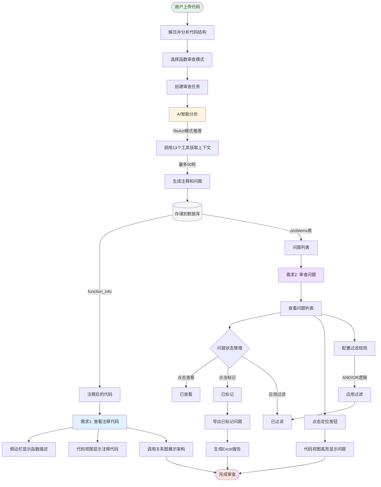
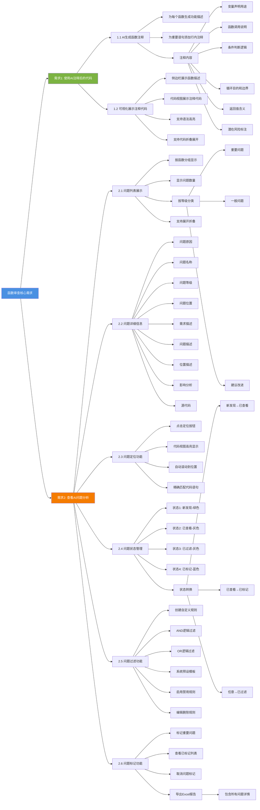

# 函数审查功能 - 用户需求文档

## 一、功能概述

函数审查是一个基于AI的智能代码审查工具，旨在帮助用户快速理解陌生代码并发现潜在问题。通过AI自动生成详细的代码注释和问题分析，大幅提升代码审查效率。

### 用户需求总体流程图

**流程说明**：

1. **代码上传阶段**：用户上传代码 → 系统解压分析 → 选择函数审查模式 → 创建任务
2. **AI分析阶段**：使用ReAct模式智能推理 → 调用13个工具获取上下文 → 生成注释和问题 → 存储到数据库
3. **需求1 - 查看注释代码**：侧边栏显示函数描述 + 代码视图显示注释 + 调用关系图展示架构
4. **需求2 - 审查问题**：
   - 查看问题列表并管理状态（新发现→已查看→已标记/已过滤）
   - 点击定位按钮在代码中高亮显示问题位置
   - 配置过滤规则过滤不关心的问题
   - 导出已标记问题为Excel报告
5. **完成审查**：获得完整的代码理解和问题清单

### 核心用户需求思维导图

## 二、核心用户需求

### 需求1：使用AI注释后的代码，提高代码理解效率

**用户痛点**：

- 面对陌生的代码库，需要花费大量时间理解代码逻辑
- 缺少注释或注释不完整，难以快速掌握函数功能
- 代码调用关系复杂，难以理解整体架构

**解决方案**：通过AI自动生成详细注释，帮助用户快速理解代码

#### 1.1 AI生成函数注释

**需求描述**：
- 为每个函数生成详细的功能描述
- 为代码中每一行重要语句添加行内注释
- 注释内容包括：
  - 变量声明的用途和含义
  - 函数调用的目的和参数说明
  - 条件判断的业务逻辑
  - 循环的目的和边界条件
  - 返回值的含义
  - 潜在风险的标注

**实现方式**：
- 后端：`FunctionReviewAgent` 使用ReAct模式智能分析代码
- 数据存储：`function_info.commented_code` 字段存储注释后的代码
- 数据存储：`function_info.function_description` 字段存储函数功能描述

**用户价值**：
- 无需阅读原始代码即可理解函数功能
- 快速掌握代码的业务逻辑和实现细节
- 降低代码理解门槛，提升审查效率

#### 1.2 可视化展示注释代码

**需求描述**：
- 在侧边栏展示函数功能描述
- 在代码视图中展示完整的注释后代码
- 支持代码语法高亮显示
- 支持代码折叠和展开

**实现方式**：
- 前端组件：`CodeMapSidebar.vue` 展示函数描述
- 前端组件：`CodeMapSourceView.vue` 展示注释后的代码
- 使用Monaco Editor提供代码高亮

**用户价值**：
- 清晰直观地查看AI生成的注释
- 对比原始代码和注释代码
- 提升代码阅读体验

---

### 需求2：查看AI给出的问题分析，快速定位和修复问题

**用户痛点**：
- 手动查找代码问题耗时耗力
- 难以发现隐藏的逻辑错误和潜在风险
- 问题太多，难以区分优先级
- 需要记录和跟踪已发现的问题

**解决方案**：通过AI自动识别问题并提供详细分析，帮助用户快速定位和修复

#### 2.1 问题列表展示

**需求描述**：
- 按函数分组显示问题
- 显示每个函数的问题数量
- 问题按等级分类（重要问题、一般问题、建议改进）
- 支持展开/折叠问题详情
- 问题列表支持滚动浏览

**实现方式**：
- 后端：`FunctionReviewAgent` 分析代码并生成问题列表
- 数据存储：`problems` 表存储问题信息
- 前端组件：`CodeMapSidebar.vue` 展示问题列表

**用户价值**：
- 一目了然地查看所有问题
- 按优先级关注重要问题
- 快速浏览问题概况

#### 2.2 问题详细信息

**需求描述**：
每个问题包含以下详细信息：
- **问题原因**（`problem_reason`）：问题的根本原因
- **问题名称**（`issue_name`）：问题的简短标题
- **问题等级**（`issue_level`）：重要问题/一般问题/建议改进
- **问题位置**（`issue_location`）：文件名+函数名
- **需求描述**（`description_requirement`）：应该如何实现
- **问题描述**（`description_issue`）：具体的问题说明
- **位置描述**（`description_location`）：精确的代码位置（文件+函数+行号+代码语句）
- **影响分析**（`description_impact`）：问题可能造成的影响
- **源代码**（`source_code`）：问题所在函数的完整代码

**实现方式**：
- 后端：AI生成结构化的问题数据
- 数据库：`problems` 表存储所有字段
- 前端：`CodeMapSidebar.vue` 展示问题详情

**用户价值**：
- 全面了解问题的来龙去脉
- 理解问题的严重程度和影响范围
- 获得修复问题的指导建议

#### 2.3 问题定位功能

**需求描述**：
- 点击"定位"按钮，在代码视图中高亮显示问题代码
- 自动滚动到问题代码所在位置
- 精确匹配问题代码语句（基于 `description_location` 中的代码语句）
- 高亮显示持续一段时间后自动消失

**实现方式**：
- 前端：`CodeMapSidebar.vue` 发送 `highlightProblem` 事件
- 前端：`CodeMapSourceView.vue` 接收事件并高亮代码
- 使用Monaco Editor的装饰器API实现高亮

**用户价值**：
- 快速定位到问题代码位置
- 无需手动搜索代码
- 提升问题修复效率

#### 2.4 问题状态管理

**需求描述**：
问题支持4种状态：
1. **新发现**（状态1）：AI刚发现的问题，用绿色指示器标识
2. **已查看**（状态2）：用户点击查看过的问题，用灰色指示器标识
3. **已过滤**（状态3）：被过滤规则过滤的问题，显示为灰色
4. **已标记**（状态4）：用户标记的重要问题，用蓝色指示器标识

**状态转换规则**：
- 新发现 → 已查看：用户点击展开问题详情
- 已查看 → 已标记：用户点击"标记"按钮
- 已标记 → 已查看：用户点击"取消标记"
- 任意状态 → 已过滤：应用过滤规则后

**实现方式**：
- 数据库：`problems.problem_status` 字段存储状态
- 后端API：`PATCH /problems/{id}/status` 更新状态
- 前端：`CodeMapSidebar.vue` 管理状态显示和更新

**用户价值**：
- 清晰区分问题的处理状态
- 避免重复查看已处理的问题
- 聚焦于未处理的新问题

#### 2.5 问题过滤功能

**需求描述**：
- 创建自定义过滤规则，过滤不关心的问题
- 支持AND逻辑：问题原因同时包含所有关键词才过滤
- 支持OR逻辑：问题原因包含任一关键词就过滤
- 从系统预设模板快速初始化常用规则
- 启用/禁用过滤规则
- 编辑和删除过滤规则
- 应用过滤后，匹配的问题变为灰色（已过滤状态）

**系统预设模板示例**：
- 过滤"可能"+"数组"（AND）：过滤不确定的数组问题
- 过滤"硬编码"或"魔法数字"（OR）：过滤编码规范问题
- 过滤"命名"相关问题：过滤命名规范问题

**实现方式**：
- 数据库：`problem_filters` 表存储过滤规则
- 后端API：`/problem_filters` 系列接口管理规则
- 前端组件：`ProblemFilterPanel.vue` 提供过滤设置界面
- 后端：应用过滤规则，更新问题状态为3（已过滤）

**用户价值**：
- 过滤掉不关心的问题，减少干扰
- 聚焦于真正重要的问题
- 提升问题审查效率

#### 2.6 问题标记功能

**需求描述**：
- 标记重要问题，方便后续跟踪
- 查看所有已标记问题的列表
- 取消问题标记
- 导出已标记问题为Excel文件，包含所有问题详情

**Excel导出内容**：
- 问题等级
- 问题名称
- 问题原因
- 问题位置
- 需求描述
- 问题描述
- 位置描述
- 影响分析
- 源代码

**实现方式**：
- 数据库：`marked_problems` 表存储标记信息
- 后端API：`/marked_problems` 系列接口管理标记
- 后端API：`/export_marked_problems` 导出Excel
- 前端：`CodeMapSidebar.vue` 提供标记和导出功能
- 使用 `openpyxl` 库生成Excel文件

**用户价值**：
- 记录和跟踪重要问题
- 方便与团队分享问题清单
- 生成问题报告文档

---

## 三、技术实现架构

### 3.1 后端架构

**核心模块**：
- `FunctionReviewAgent`：基于ReAct模式的智能审查Agent
- `FileFunctionReviewer`：文件+函数集成审查器
- `analysis_runner`：审查任务运行器

**AI能力**：
- 使用OpenAI GPT模型进行代码分析
- 支持Function Calling，Agent可主动调用工具获取信息
- 最多50轮推理，建议20轮内完成
- 支持上下文超出时降级到简化模式

**工具集（13个工具）**：
1. `get_dependency_function`：获取被调用函数的代码
2. `get_global_variable`：获取全局变量定义
3. `search_function_calls`：搜索函数调用位置
4. `list_all_globals`：列出所有全局变量
5. `get_file_outline`：获取文件大纲
6. `read_file_range`：按行范围读取文件
7. `get_call_graph`：获取函数调用关系图
8. `search_code`：搜索代码关键字
9. `list_directory`：列出目录内容
10. `search_function_by_name`：按名称搜索函数
11. `search_function_in_file`：在文件中搜索函数
12. `get_function_context`：获取函数上下文
13. `get_variable_usage`：追踪变量使用

**数据库设计**：
- `tasks`：任务表
- `files`：文件表
- `functions`：函数表（存储function_info）
- `problems`：问题表（存储问题详情和状态）
- `problem_filters`：过滤规则表
- `marked_problems`：标记问题表

### 3.2 前端架构

**核心组件**：
- `ConfigurationItemCodeReview.vue`：主入口页面
- `CodeMapMultiMode.vue`：多模式代码地图容器
- `functionCodemap/`：函数审查相关组件
  - `CodeMapSidebar.vue`：侧边栏（展示问题和统计）
  - `CodeMapSourceView.vue`：代码视图（展示注释代码）
  - `CodeMapGraph.vue`：调用关系图
  - `CodeMapTree.vue`：文件树
  - `CodeMapToolbar.vue`：工具栏
  - `CodeMapFullscreen.vue`：全屏模式
  - `ProblemFilterPanel.vue`：问题过滤面板

**技术栈**：
- Vue 3 + Composition API
- Element Plus UI组件库
- Monaco Editor 代码编辑器
- Axios HTTP客户端
- Vue Router 路由管理

### 3.3 API接口

**任务管理**：
- `POST /start_analysis`：启动函数审查任务
- `GET /task_progress/{task_id}`：查询任务进度
- `POST /cancel_task/{task_id}`：取消任务

**代码地图**：
- `GET /codemap/{task_id}`：获取代码地图数据
- `GET /codemap/{task_id}/source/{file_path}`：获取文件源码

**问题管理**：
- `PATCH /problems/{id}/status`：更新问题状态
- `GET /marked_problems`：获取已标记问题
- `POST /marked_problems`：标记问题
- `DELETE /marked_problems`：取消标记
- `POST /export_marked_problems/{task_id}`：导出已标记问题

**过滤规则**：
- `GET /problem_filters`：获取过滤规则列表
- `POST /problem_filters`：创建过滤规则
- `PUT /problem_filters/{id}`：更新过滤规则
- `DELETE /problem_filters/{id}`：删除过滤规则
- `POST /problem_filters/apply`：应用过滤规则
- `POST /problem_filters/init_from_system_templates`：从系统模板初始化

---

## 四、用户使用流程

### 4.1 启动函数审查

1. 用户上传代码压缩包
2. 系统解压并分析代码结构
3. 用户选择"函数审查"模式
4. 系统创建审查任务并启动后台分析
5. 用户可以查看任务进度

### 4.2 查看注释代码

1. 任务完成后，进入代码地图页面
2. 在左侧文件树中选择文件
3. 在代码视图中查看AI生成的注释代码
4. 在侧边栏查看函数功能描述
5. 通过调用关系图理解函数关系

### 4.3 审查问题

1. 在侧边栏查看问题列表
2. 点击问题查看详细信息（状态变为"已查看"）
3. 点击"定位"按钮在代码中高亮显示问题
4. 对重要问题点击"标记"按钮（状态变为"已标记"）
5. 使用过滤功能过滤不关心的问题

### 4.4 导出问题报告

1. 点击"查看标记问题"查看所有已标记问题
2. 点击"导出已标记"生成Excel报告
3. 下载Excel文件，包含所有问题详情
4. 与团队分享问题清单

