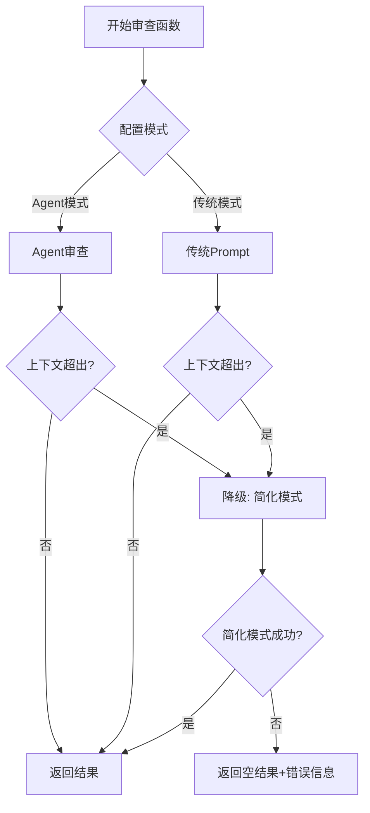

# 上下文超出处理方案

## 问题背景

在使用AI审查代码时，可能会遇到以下情况导致上下文超出（Context Length Exceeded）：

1. **函数代码过长** - 超大型函数（几千行）
2. **依赖信息过多** - Agent调用了大量工具获取依赖函数
3. **对话轮次过多** - Agent进行了多轮推理，累积的对话历史过长
4. **全局变量过多** - 项目包含大量全局变量定义

### 典型错误信息

不同AI服务商的错误信息格式：

```python
# OpenAI
"This model's maximum context length is 8192 tokens. However, your messages resulted in 12345 tokens."

# 其他常见格式
"context_length_exceeded"
"maximum context length exceeded"
"input is too long"
"token limit exceeded"
```

## 当前检测机制

### 问题1: 无法预先知道确切token数

**原因**：
- 不同模型的tokenizer算法不同
- 无法准确预测token数量（只能粗略估算）
- 需要考虑：函数代码 + 系统提示词 + 工具定义 + 对话历史

**解决方案**：
- 使用**后验检测** + **降级处理**
- 粗略估算 + 安全阈值（80%）作为预警
- 发生错误时自动降级

### 问题2: 不同场景的token消耗

| 场景 | 估算token数 | 说明 |
|------|------------|------|
| Agent模式初始 | 2000-5000 | 系统提示词 + 13个工具定义 + 函数代码 |
| Agent第10轮 | 8000-15000 | 累积对话 + 工具结果 |
| 传统模式 | 5000-20000 | 函数代码 + 所有依赖函数 + 全局变量 |
| 简化模式 | 1000-3000 | 仅函数代码 + 基础提示词 |

## 完整处理方案

### 1. 错误检测

**文件**: `context_overflow_handler.py`

```python
def is_context_overflow_error(error: Exception) -> bool:
    """判断是否是上下文超出错误"""
    error_str = str(error).lower()
    error_type = type(error).__name__.lower()
    
    context_overflow_keywords = [
        'context_length_exceeded',
        'maximum context length',
        'context window',
        'too many tokens',
        'exceed',
        'token limit',
        'context size',
        'input is too long'
    ]
    
    return (
        'badrequesterror' in error_type or
        'invalidrequesterror' in error_type or
        any(keyword in error_str for keyword in context_overflow_keywords)
    )
```

**优点**：
- ✅ 兼容所有AI服务商的错误格式
- ✅ 通过关键词匹配，覆盖各种表述
- ✅ 同时检查错误类型和错误消息

### 2. 三层降级策略



#### 第一层：Agent模式（带工具调用）

**特点**：
- ✅ 最智能，AI主动探索
- ✅ 只查看必要的依赖
- ❌ Token消耗可能较高（多轮对话累积）

**触发降级条件**：
- API返回上下文超出错误
- Agent在任意轮次遇到错误

#### 第二层：传统模式（一次性给所有信息）

**特点**：
- ✅ 一次性提供所有依赖
- ✅ 不需要多轮对话
- ❌ 可能包含不必要的信息

**触发降级条件**：
- API返回上下文超出错误

#### 第三层：简化模式（仅函数本身）

**特点**：
- ✅ Token消耗最少
- ✅ 几乎不会超出上下文
- ❌ 缺少依赖信息，分析质量较低
- ❌ 只能发现函数内部的明显问题

**简化提示词**：
```python
def build_simplified_prompt(function_code, function_name, file_path, forbidden_rules):
    prompt = f"""你是一个专业的C/C++代码审查专家。请审查以下函数，找出确定存在的问题。

**重要原则**：
1. 只提100%确定会发生的问题
2. 如果不确定是否有问题，请不要提
3. 专注于代码本身可以看到的明显错误

**禁止报告的问题类型**：
{forbidden_rules}

**待审查函数**：
文件路径：{file_path}
函数名：{function_name}

{function_code}

**审查重点**：
1. 明显的逻辑错误（如除零、空指针解引用等）
2. 数组越界（必须能证明索引一定超出范围）
3. 内存泄漏（必须能证明一定会泄漏）
4. 死代码（永远不会执行的代码）

请返回JSON格式结果...
"""
    return prompt
```

### 3. 代码集成点

#### A. function_review_agent.py

**位置**: `_call_ai_with_tools` 方法

```python
try:
    response = self.ai_client.client.chat.completions.create(**api_params)
except Exception as api_error:
    from .context_overflow_handler import is_context_overflow_error
    
    if is_context_overflow_error(api_error):
        log_concurrent_warning(f"[Agent审查] 检测到上下文超出")
        return {
            "finished": True,
            "result": None,
            "_context_overflow": True,  # 特殊标记
            "_error": str(api_error)
        }
    else:
        raise  # 其他错误继续抛出
```

**位置**: `review_function` 方法（ReAct循环）

```python
response = self._call_ai_with_tools(conversation, current_iteration)

# 检查是否遇到上下文超出
if response.get('_context_overflow'):
    log_concurrent_warning(f"[Agent审查] 在第 {current_iteration} 轮遇到上下文超出")
    return {
        "problems": [],
        "function_info": {},
        "_context_overflow": True,
        "_error": response.get('_error', '')
    }
```

#### B. analysis_runner.py

**位置**: `_process_single_function_concurrent` 方法

```python
# Agent模式降级处理
if ENABLE_FUNCTION_REVIEW_AGENT:
    result = agent.review_function(...)
    
    # 检查Agent是否遇到上下文超出
    if result.get('_context_overflow'):
        log_concurrent_warning(f"[Agent模式] 检测到上下文超出，切换到简化模式")
        
        from .context_overflow_handler import review_with_simplified_mode
        result = review_with_simplified_mode(
            function_code=func_data_dict['source_code'],
            function_name=func_data_dict['function_name'],
            file_path=func_data_dict['file_path'],
            forbidden_rules=get_rules(),
            ai_client=ai_client
        )
```

**位置**: 异常捕获

```python
except Exception as e:
    from .context_overflow_handler import is_context_overflow_error, review_with_simplified_mode
    
    if is_context_overflow_error(e):
        log_concurrent_warning(f"检测到上下文超出错误，切换到简化模式审查")
        
        result = review_with_simplified_mode(
            function_code=func_data_dict['source_code'],
            function_name=func_data_dict['function_name'],
            file_path=func_data_dict['file_path'],
            forbidden_rules=get_rules(),
            ai_client=ai_client
        )
        
        problems = result.get("problems", [])
        function_info = result.get("function_info", {})
    else:
        log_concurrent_error(f"AI分析失败", "ai_analyzer", e)
```

## 预防性措施（可选）

### 1. Token预估

```python
from .context_overflow_handler import estimate_context_tokens, should_use_simplified_mode

# 估算token数
token_info = estimate_context_tokens(
    function_code=function_code,
    conversation_history=conversation,
    tools_count=13  # Agent有13个工具
)

# 判断是否应该预先使用简化模式
if should_use_simplified_mode(
    estimated_tokens=token_info['total_tokens'],
    model_name=model_name,
    safety_margin=0.8  # 使用80%作为安全阈值
):
    log_concurrent_warning(f"预估token数 {token_info['total_tokens']} 接近上限，直接使用简化模式")
    # 直接使用简化模式...
```

**优点**：
- 可以提前避免部分超出情况
- 减少API调用失败次数

**缺点**：
- 估算不准确（只能粗略估计）
- 可能过于保守，降低审查质量

**建议**：
- ❌ 不建议使用预防性措施
- ✅ 优先使用后验检测 + 自动降级
- ✅ 让AI尝试最优模式，失败时再降级

### 2. 函数代码长度限制

```python
# 如果函数超过5000行，自动使用简化模式
if len(function_code.splitlines()) > 5000:
    log_concurrent_warning(f"函数代码过长（{len(function_code.splitlines())}行），使用简化模式")
    # 使用简化模式...
```

**建议**：
- ⚠️ 可以作为补充措施
- 阈值建议：5000行（极少见）

## 日志追踪

### 正常流程

```log
[ai_analyzer] 开始分析函数: calculate_sum in math.c (ID: a1b2c3d4)
[ai_analyzer] [Agent模式] 使用Agent审查函数: calculate_sum
[function_review_agent] [Agent审查] 开始审查函数: calculate_sum
[function_review_agent] 🔄 [开始第 1 轮推理]
[function_review_agent] 🔧 [第 1 轮] AI请求调用 2 个工具：['get_dependency_function', 'get_global_variable']
...
[function_review_agent] 🎯 [第 5 轮完成] 审查结束，发现 2 个问题
[ai_analyzer] 函数 calculate_sum 分析完成，发现 2 个问题
```

### 上下文超出 - Agent模式降级

```log
[ai_analyzer] 开始分析函数: huge_function in large_file.c (ID: x9y8z7w6)
[ai_analyzer] [Agent模式] 使用Agent审查函数: huge_function
[function_review_agent] [Agent审查] 开始审查函数: huge_function
[function_review_agent] 🔄 [开始第 1 轮推理]
...
[function_review_agent] 🔄 [开始第 12 轮推理]
[function_review_agent] [Agent审查] 检测到上下文超出，对话轮数: 12
[function_review_agent] [Agent审查] 在第 12 轮遇到上下文超出，需要降级到简化模式
[ai_analyzer] [Agent模式] 检测到上下文超出，切换到简化模式
[context_overflow_handler] [降级模式] 使用简化模式审查函数 huge_function（无工具调用，无依赖信息）
[context_overflow_handler] [降级模式] 简化提示词长度: 2345 字符
[context_overflow_handler] [降级模式] 审查完成，发现 1 个问题
[ai_analyzer] 简化模式审查成功，发现 1 个问题 (ID: x9y8z7w6)
```

### 上下文超出 - 传统模式降级

```log
[ai_analyzer] 开始分析函数: complex_func in utils.c (ID: p5q4r3s2)
[ai_analyzer] [传统模式] 使用传统prompt审查函数: complex_func
[ai_analyzer] 检测到上下文超出错误，切换到简化模式审查 (ID: p5q4r3s2)
[context_overflow_handler] [降级模式] 使用简化模式审查函数 complex_func（无工具调用，无依赖信息）
[context_overflow_handler] [降级模式] 审查完成，发现 0 个问题
[ai_analyzer] 简化模式审查成功，发现 0 个问题 (ID: p5q4r3s2)
```

## 验证方案

### 1. 单元测试

创建测试文件：`test_context_overflow.py`

```python
def test_is_context_overflow_error():
    """测试上下文超出错误检测"""
    # OpenAI格式
    error1 = Exception("This model's maximum context length is 8192 tokens")
    assert is_context_overflow_error(error1) == True
    
    # 其他格式
    error2 = Exception("context_length_exceeded")
    assert is_context_overflow_error(error2) == True
    
    # 非上下文错误
    error3 = Exception("Network error")
    assert is_context_overflow_error(error3) == False

def test_simplified_mode():
    """测试简化模式审查"""
    result = review_with_simplified_mode(
        function_code="int main() { return 0; }",
        function_name="main",
        file_path="test.c",
        forbidden_rules="规则1, 规则2",
        ai_client=mock_ai_client
    )
    
    assert "problems" in result
    assert "function_info" in result
```

### 2. 集成测试

```python
def test_agent_fallback_to_simplified():
    """测试Agent模式降级到简化模式"""
    # 模拟Agent遇到上下文超出
    # 验证是否自动降级并成功完成审查
    pass

def test_traditional_fallback_to_simplified():
    """测试传统模式降级到简化模式"""
    # 模拟传统模式遇到上下文超出
    # 验证是否自动降级并成功完成审查
    pass
```

### 3. 手动测试

**测试用例1：超大函数**
- 准备一个5000+行的函数
- 启动审查，观察是否自动降级
- 检查日志中的降级记录

**测试用例2：大量依赖**
- 准备一个调用了50+个依赖函数的函数
- 使用Agent模式审查
- 观察是否在多轮对话后触发降级

**测试用例3：验证结果质量**
- 对比正常模式和简化模式的审查结果
- 确认简化模式虽然质量较低，但不会完全失败

## 模型上下文限制参考

| 模型 | 上下文限制 | 说明 |
|------|-----------|------|
| GPT-4 | 8,192 tokens | 基础版本 |
| GPT-4-32K | 32,768 tokens | 扩展版本 |
| GPT-4-Turbo | 128,000 tokens | 最新版本 |
| GPT-3.5-Turbo | 4,096 tokens | 基础版本 |
| GPT-3.5-Turbo-16K | 16,384 tokens | 扩展版本 |
| Qwen2.5-Coder 7B/14B/32B | 32,768 tokens | 国产模型 |
| Qwen-Coder-Plus | 131,072 tokens | 高级版本 |
| DeepSeek-Coder | 16,384 tokens | 国产模型 |
| Claude-3 | 200,000 tokens | 最大上下文 |

**Token估算公式**：
- 英文：1 token ≈ 4 字符
- 中文：1 token ≈ 1.5-2 字符
- 代码：1 token ≈ 3-4 字符
- **保守估计：1 token = 3 字符**

## 总结

### ✅ 优势

1. **自动降级** - 无需人工干预，自动切换到简化模式
2. **兼容性强** - 支持所有AI服务商的错误格式
3. **多层保护** - Agent → 传统 → 简化，三层降级策略
4. **不影响正常流程** - 只在遇到错误时才触发
5. **日志完整** - 清晰记录降级过程

### ⚠️ 局限

1. **简化模式质量较低** - 缺少依赖信息
2. **无法完全预防** - 只能后验检测
3. **极端情况可能失败** - 如果函数本身就超出上下文

### 🎯 建议配置

```json
{
  "openai": {
    "model_name": "qwen2.5-coder:32b",
    "base_url": "http://localhost:11434/v1"
  },
  "model_params": {
    "temperature": 0.2,
    "max_tokens": -1
  },
  "review": {
    "enable_function_review_agent": true,
    "max_iterations": 50,
    "max_tool_calls_per_iteration": 5
  }
}
```

**关键设置**：
- `max_tokens: -1` - 不限制输出长度，使用模型默认
- `enable_function_review_agent: true` - 优先使用Agent模式
- `max_iterations: 50` - 给Agent足够的探索空间

---

**创建时间**: 2024年
**状态**: ✅ 已实现
**优先级**: P1（重要功能）
**影响范围**: 所有使用AI审查的场景
