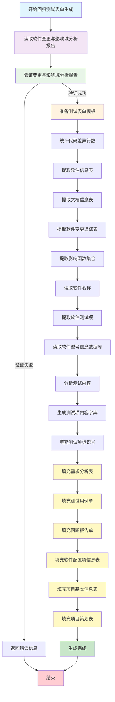

# 回归测试表单生成流程图 - 无策划表情况

## 流程概述

本流程图展示了回归测试在**无策划表**情况下的完整表单生成过程。

## 流程图

## 关键函数调用

### 主函数
- `ceshibiaodan_tianchong()` - 主要的表单填充函数

### 核心处理步骤
1. **文档验证**: `check_word_document_huigui()` - 检查软件变更与影响域分析报告
2. **模板准备**: `copy_excel_files()` - 复制测试表单模板
3. **代码分析**: `special_lines()` - 统计代码差异行数
4. **信息提取**: `read_word_tables()` - 提取文档中的关键信息
5. **软件信息**: `ruanjian_name_tiqu()` - 提取软件名称
6. **型号信息**: `xinghaoxinxi_excel_to_dict()` - 读取软件型号信息数据库
7. **测试内容**: `read_huigui_wendang_document()` - 生成测试项内容
8. **标识填充**: `fill_test_identifiers()` - 填充测试项标识号

### 表单填充函数
1. `write_to_excel_cell_xuqiubiao()` - 填充需求分析表
2. `write_to_excel_cell_yonglidan()` - 填充测试用例单
3. `write_to_excel_cell_wentidan()` - 填充问题报告单
4. `write_to_excel_cell_peizhixiang()` - 填充软件配置项信息表
5. `write_to_excel_cell_xiangmuxinxi()` - 填充项目基本信息表
6. `write_to_excel_cell_cehuabiao()` - 填充项目策划表

## 输入文档要求

- **软件变更与影响域分析报告** (.docx格式)
- 包含软件信息表、文档信息表、软件变更追踪表等关键信息

## 输出文件

- **需求分析表(精准测试工具生成).xlsx** - 包含6个工作表的完整测试表单

## 资源文件依赖

- `D:/baxiang_ceshi/DataBase/软件型号信息数据库.xlsx` - 软件型号信息数据库
- `D:/baxiang_ceshi/tree_sitter_wenjian/` - 测试表单模板文件夹
- `D:/baxiang_ceshi/CeshiDan/` - 测试表单输出文件夹 