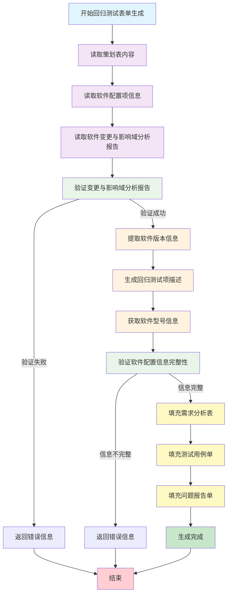

# 回归测试表单生成流程图 - 有策划表情况

## 流程概述

本流程图展示了回归测试在**有策划表**情况下的完整表单生成过程。

## 流程图

## 关键函数调用

### 主函数
- `ceshibiaodan_tianchong_have_cehua()` - 有策划表的表单填充函数

### 核心处理步骤
1. **策划表读取**: `cehuabiao_duqu()` - 读取策划表内容和重复项检查
2. **配置信息读取**: `ruanjianxinxi_duqu()` - 从软件配置信息中读取基本信息
3. **文档验证**: `check_word_document_huigui()` - 检查软件变更与影响域分析报告
4. **测试内容生成**: `read_huigui_wendang_document()` - 生成回归测试项描述
5. **信息验证**: 验证软件名称、软件标识、软件版本的完整性

### 表单填充函数
1. `write_to_excel_cell_xuqiubiao_cehua()` - 填充需求分析表（策划表版本）
2. `write_to_excel_cell_yonglidan_cehua()` - 填充测试用例单（策划表版本）
3. `write_to_excel_cell_wentidan_cehua()` - 填充问题报告单（策划表版本）

## 输入文档要求

### 必需文档
- **策划表** (.xlsx格式) - 包含软件配置项信息表等
- **软件变更与影响域分析报告** (.docx格式)

### 策划表内容要求
- 软件配置项信息表中必须包含：
  - 软件名称
  - 软件标识
  - 软件版本

## 输出文件

- **策划表** - 在原有策划表基础上填充需求分析表、测试用例单、问题报告单

## 关键特点

1. **简化流程**: 相比无策划表情况，有策划表的流程更加简化
2. **基于策划表**: 主要基于已有的策划表内容进行填充
3. **配置验证**: 严格验证软件配置信息的完整性
4. **回归专用**: 专门针对回归测试的内容生成

## 与无策划表的区别

1. **输入不同**: 需要预先准备好的策划表
2. **流程简化**: 不需要重新生成项目基本信息表、软件配置项信息表、项目策划表
3. **验证严格**: 对策划表中的配置信息进行严格验证
4. **输出位置**: 直接在策划表文件中填充内容 