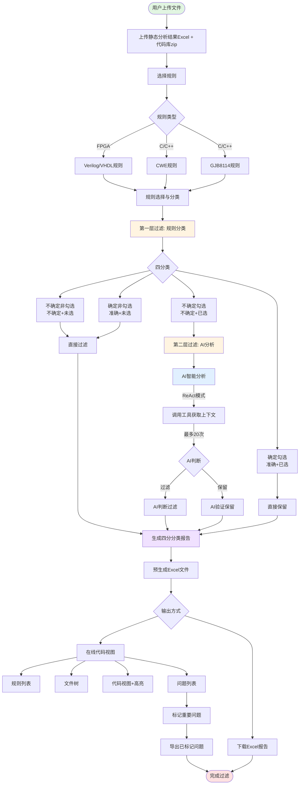

# 静态分析问题智能过滤工具 - 用户需求文档

## 一、功能概述

静态分析问题智能过滤工具是一个基于规则和AI的智能问题筛选系统，旨在帮助用户从海量的静态分析结果中快速筛选出真正需要关注的问题，并生成标准化的问题报告单。

### 用户需求总体流程图



**流程说明**：

1. **文件上传阶段**：上传静态分析结果Excel + 代码库zip → 选择规则类型（GJB8114/CWE/FPGA）
2. **第一层过滤 - 规则分类**：将问题按准确性和用户选择进行四分类
   - 确定勾选：准确规则+已选 → 直接保留
   - 确定非勾选：准确规则+未选 → 直接过滤
   - 不确定勾选：不确定规则+已选 → 进入AI分析
   - 不确定非勾选：不确定规则+未选 → 直接过滤
3. **第二层过滤 - AI分析**：使用ReAct模式智能分析代码上下文 → AI判断保留或过滤
4. **生成报告**：预生成四分分类Excel文件并缓存
5. **输出方式**：
   - 下载Excel报告：四个Sheet分别对应四分类
   - 在线代码视图：规则列表 + 文件树 + 代码高亮 + 问题列表
6. **问题管理**：标记重要问题 → 导出已标记问题Excel

### 核心用户需求思维导图

```mermaid
graph LR
    Root[静态分析过滤核心需求] --> Req1[需求1: 智能过滤问题]
    Root --> Req2[需求2: 生成标准化报告]
    
    Req1 --> R1_1[1.1 第一层过滤: 规则分类]
    Req1 --> R1_2[1.2 规则动态调整]
    Req1 --> R1_3[1.3 默认配置管理]
    Req1 --> R1_4[1.4 第二层过滤: AI分析]
    Req1 --> R1_5[1.5 自定义关键词过滤]
    
    R1_1 --> R1_1_1[四分类机制]
    R1_1_1 --> R1_1_1_1[确定勾选: 准确+已选]
    R1_1_1 --> R1_1_1_2[确定非勾选: 准确+未选]
    R1_1_1 --> R1_1_1_3[不确定勾选: 不确定+已选]
    R1_1_1 --> R1_1_1_4[不确定非勾选: 不确定+未选]
    R1_1 --> R1_1_2[规则展示]
    R1_1_2 --> R1_1_2_1[左列: 确定规则-绿色]
    R1_1_2 --> R1_1_2_2[右列: 不确定规则-黄色]
    R1_1 --> R1_1_3[规则选择]
    R1_1_3 --> R1_1_3_1[全选/全不选]
    R1_1_3 --> R1_1_3_2[仅选确定规则]
    R1_1_3 --> R1_1_3_3[仅选不确定规则]
    
    R1_2 --> R1_2_1[移至不确定规则]
    R1_2 --> R1_2_2[移至确定规则]
    R1_2 --> R1_2_3[rule_overrides配置]
    
    R1_3 --> R1_3_1[保存默认配置]
    R1_3_1 --> R1_3_1_1[需要管理员密码]
    R1_3 --> R1_3_2[加载默认配置]
    R1_3 --> R1_3_3[配置内容]
    R1_3_3 --> R1_3_3_1[规则选择列表]
    R1_3_3 --> R1_3_3_2[规则分类覆盖]
    R1_3_3 --> R1_3_3_3[关键词过滤规则]
    R1_3_3 --> R1_3_3_4[问题数量限制]
    
    R1_4 --> R1_4_1[ReAct模式推理]
    R1_4 --> R1_4_2[Function Calling]
    R1_4_2 --> R1_4_2_1[read_file_content]
    R1_4_2 --> R1_4_2_2[search_function_definition]
    R1_4_2 --> R1_4_2_3[search_variable_usage]
    R1_4_2 --> R1_4_2_4[get_call_graph]
    R1_4 --> R1_4_3[AI判断标准]
    R1_4_3 --> R1_4_3_1[问题是否真实存在]
    R1_4_3 --> R1_4_3_2[是否影响功能安全]
    R1_4_3 --> R1_4_3_3[是否符合规则本意]
    R1_4 --> R1_4_4[最多20次工具调用]
    
    R1_5 --> R1_5_1[为特定规则设置关键词]
    R1_5 --> R1_5_2[包含关键词自动过滤]
    R1_5 --> R1_5_3[持久化到默认配置]
    
    Req2 --> R2_1[2.1 四分分类报告单]
    Req2 --> R2_2[2.2 预生成机制]
    Req2 --> R2_3[2.3 在线代码视图]
    Req2 --> R2_4[2.4 问题状态管理]
    Req2 --> R2_5[2.5 问题标记与导出]
    Req2 --> R2_6[2.6 双规则类型支持]
    
    R2_1 --> R2_1_1[Sheet1: 确定勾选]
    R2_1 --> R2_1_2[Sheet2: 确定非勾选]
    R2_1 --> R2_1_3[Sheet3: 不确定勾选]
    R2_1 --> R2_1_4[Sheet4: 不确定非勾选]
    R2_1 --> R2_1_5[列结构]
    R2_1_5 --> R2_1_5_1[规则编号和名称]
    R2_1_5 --> R2_1_5_2[问题描述]
    R2_1_5 --> R2_1_5_3[文件路径和行号]
    R2_1_5 --> R2_1_5_4[代码片段]
    R2_1_5 --> R2_1_5_5[严重程度]
    R2_1_5 --> R2_1_5_6[AI分析结果]
    
    R2_2 --> R2_2_1[分析完成后立即生成]
    R2_2 --> R2_2_2[缓存到临时目录]
    R2_2 --> R2_2_3[下载时直接返回]
    
    R2_3 --> R2_3_1[四栏布局]
    R2_3_1 --> R2_3_1_1[最左: 规则列表]
    R2_3_1 --> R2_3_1_2[左: 文件树]
    R2_3_1 --> R2_3_1_3[中: 代码视图+高亮]
    R2_3_1 --> R2_3_1_4[右: 问题列表]
    R2_3 --> R2_3_2[Monaco Editor]
    R2_3 --> R2_3_3[问题行高亮]
    R2_3 --> R2_3_4[问题定位]
    
    R2_4 --> R2_4_1[状态1: 新发现-绿色]
    R2_4 --> R2_4_2[状态2: 已查看-灰色]
    R2_4 --> R2_4_3[状态3: 已过滤-灰色]
    R2_4 --> R2_4_4[状态4: 已标记-蓝色]
    
    R2_5 --> R2_5_1[标记重要问题]
    R2_5 --> R2_5_2[查看已标记列表]
    R2_5 --> R2_5_3[导出已标记Excel]
    
    R2_6 --> R2_6_1[GJB8114规则]
    R2_6 --> R2_6_2[CWE规则]
    R2_6 --> R2_6_3[独立分析和进度]
    R2_6 --> R2_6_4[分别生成报告]
    
    style Root fill:#4a90e2,color:#fff
    style Req1 fill:#7cb342,color:#fff
    style Req2 fill:#f57c00,color:#fff
```



### 1.1 工具定位

本工具作为静态分析工具（如PC-Lint、Klocwork等）的后处理工具，解决以下核心痛点：
- **问题过多**：静态分析工具通常会报告大量问题（数千甚至上万个），人工筛选耗时耗力
- **误报率高**：很多报告的问题并非真正的缺陷，需要结合代码上下文判断
- **格式不统一**：不同工具的输出格式各异，难以直接用于问题跟踪和管理
- **缺乏优先级**：所有问题混在一起，难以区分哪些需要优先处理

### 1.2 支持的代码类型

工具支持两大类代码的静态分析结果过滤：

**C/C++代码**：
- 规则标准：GJB8114（国军标）+ CWE（通用弱点枚举）
- 规则数量：GJB8114约100+条，CWE约200+条
- 应用场景：嵌入式系统、航空航天、军工软件等

**FPGA代码**：
- 规则标准：Verilog强制准则 + Verilog建议准则 + VHDL强制准则 + VHDL建议准则
- 规则数量：约200+条
- 应用场景：可编程逻辑器件、硬件描述语言开发

### 1.3 核心价值

- **效率提升90%**：通过两层智能过滤，将数千个问题缩减到数十个真正需要关注的问题
- **准确率提升80%**：AI分析代码上下文，大幅降低误报率
- **标准化输出**：自动生成符合规范的问题报告单，可直接用于问题跟踪
- **灵活配置**：支持自定义规则选择、关键词过滤、问题数量限制等

---

## 二、核心用户需求

### 需求1：智能过滤问题，快速定位真正的缺陷

**用户痛点**：
- 静态分析工具报告数千个问题，人工逐一审查不现实
- 很多问题是误报或不重要的编码规范问题
- 难以区分哪些问题需要优先处理
- 缺乏代码上下文，无法判断问题是否真实存在

**解决方案**：通过两层过滤机制，智能筛选出真正需要关注的问题

#### 1.1 第一层过滤：规则分类与选择

**需求描述**：
将所有静态分析问题按照规则的准确性和用户选择进行四分类，实现粗粒度过滤。

**四分类机制**：

1. **确定勾选**（Accurate + Selected）
   - 定义：语法分析即可准确识别的规则 + 用户勾选
   - 特点：准确率高，误报率低
   - 处理方式：进入第二层AI过滤
   - 示例规则（GJB8114）：
     - `GJB_R_01_01_01`：禁止使用gets函数
     - `GJB_R_01_07_11`：禁止使用goto语句
   - 示例规则（FPGA Verilog）：
     - `R-2-1`：命名必须以字母开始
     - `R-10-3`：组合电路必须使用阻塞赋值

2. **确定非勾选**（Accurate + Unselected）
   - 定义：准确规则 + 用户未勾选
   - 特点：虽然准确但用户不关心
   - 处理方式：直接过滤，不进入AI分析
   - 用途：过滤不关心的编码规范问题

3. **不确定勾选**（Uncertain + Selected）
   - 定义：需要AI分析代码上下文的规则 + 用户勾选
   - 特点：可能存在误报，需要AI判断
   - 处理方式：进入第二层AI过滤
   - 示例规则（GJB8114）：
     - `GJB_R_01_01_02`：检查缓冲区溢出风险
     - `GJB_R_01_03_01`：检查未初始化变量使用
   - 示例规则（FPGA Verilog）：
     - `R-14-1`：状态机禁止出现死锁状态
     - `R-13-7`：禁止在组合逻辑电路中使用反馈

4. **不确定非勾选**（Uncertain + Unselected）
   - 定义：不确定规则 + 用户未勾选
   - 特点：用户不关心且可能误报
   - 处理方式：直接过滤，不进入AI分析

**实现方式**：

**后端**：
- 规则数据库：
  - C/C++：`gjb8114_rules.db`（GJB8114规则）+ `cwe_rules.db`（CWE规则）
  - FPGA：PostgreSQL数据库存储Verilog/VHDL规则
- 规则字段：
  - `rule_code`：规则编号
  - `rule_description`：规则描述
  - `accuracy_type`：准确性类型（accurate/uncertain）
  - `category`：规则类别
  - `detection_method`：检测方法

**前端**：
- 组件：`StaticAnalysisFilter.vue`（主界面）
- 规则展示：左右两列布局
  - 左列：确定规则（绿色标识）
  - 右列：不确定规则（黄色标识）
- 规则选择：
  - 全选/全不选
  - 仅选确定规则
  - 仅选不确定规则
  - 单个规则勾选/取消勾选

**用户价值**：
- 快速过滤掉不关心的规则问题
- 聚焦于重要的规则
- 减少后续AI分析的工作量

#### 1.2 规则动态调整

**需求描述**：
用户可以根据项目特点，动态调整规则的准确性分类，将确定规则移至不确定规则，或反之。

**调整场景**：
- 某个"确定规则"在特定项目中误报率高 → 移至不确定规则，让AI分析
- 某个"不确定规则"经验证准确率高 → 移至确定规则，减少AI分析负担

**实现方式**：
- 前端：规则卡片上的"移至不确定"/"移至确定"按钮
- 后端：`rule_overrides`配置，格式：
  ```json
  {
    "gjb": {"GJB_R_01_07_11": "uncertain"},
    "cwe": {"S_01_01": "accurate"}
  }
  ```
- 持久化：保存到默认配置中，下次使用时自动应用

**用户价值**：
- 根据项目特点优化过滤策略
- 提升过滤准确率
- 减少不必要的AI分析

#### 1.3 默认配置管理

**需求描述**：
用户可以将当前的规则选择和分类调整保存为默认配置，下次使用时自动加载，无需重复配置。

**配置内容**：
- GJB8114规则选择列表
- CWE规则选择列表
- 规则分类覆盖配置（rule_overrides）
- 自定义关键词过滤规则（custom_filters）
- 每个规则最多保留的问题数量（max_issues_per_rule）

**权限控制**：
- 保存默认配置需要管理员密码（默认：159357）
- 防止误操作覆盖团队配置

**实现方式**：
- 后端：`default_rules_config.py`管理配置
- 配置文件：`default_selected_rules.json`
- API：
  - `POST /save_default_config`：保存配置（需密码）
  - `GET /load_default_config`：加载配置
  - `GET /has_default_config`：检查是否有默认配置

**用户价值**：
- 避免重复配置，提升效率
- 团队统一配置标准
- 快速开始分析任务

#### 1.4 第二层过滤：AI智能分析

**需求描述**：
对"确定勾选"和"不确定勾选"的问题，使用AI分析代码上下文，判断问题是否真实存在，实现精细化过滤。

**AI分析流程**：

1. **问题分流**：
   - 确定勾选的问题：直接保留（准确率高，无需AI分析）
   - 不确定勾选的问题：进入AI分析队列

2. **AI分析**（基于ReAct模式）：
   - 读取问题代码片段
   - 使用Function Calling主动调用工具获取上下文：
     - `read_file_content`：读取完整文件内容
     - `search_function_definition`：搜索函数定义
     - `search_variable_usage`：搜索变量使用
     - `get_call_graph`：获取函数调用关系
     - `search_code_pattern`：搜索代码模式
   - 综合分析后给出判断：
     - **保留**：问题真实存在
     - **过滤**：误报或不重要

3. **AI判断标准**：
   - 问题是否真实存在？
   - 问题是否会影响功能或安全？
   - 问题是否符合规则的本意？
   - 是否有合理的例外情况？

**AI能力**：
- 模型：OpenAI GPT系列
- 最大工具调用次数：20次（防止过度调用）
- 支持的代码类型：C/C++、Verilog、VHDL
- 分析速度：约5-10秒/问题

**实现方式**：
- 后端：
  - `CodeAnalysisAgentV2`：C/C++代码分析Agent
  - `FpgaAIAgent`：FPGA代码分析Agent
  - `EnhancedStaticAnalysisFilterService`：增强服务，协调AI分析
- 前端：
  - `AIProgressBall.vue`：AI分析进度悬浮球
  - `StaticProgressDisplay.vue`：详细进度显示面板

**用户价值**：
- 大幅降低误报率（80%+）
- 无需人工逐一审查代码
- 自动化、智能化的问题筛选

#### 1.5 自定义关键词过滤

**需求描述**：
用户可以为特定规则设置关键词过滤，当问题描述中包含这些关键词时，自动过滤该问题。

**使用场景**：
- 过滤特定的误报模式
- 过滤已知的例外情况
- 过滤不关心的特定代码模式

**配置方式**：
```json
{
  "GJB_R_01_01_01": ["test", "demo"],
  "S_01_01": ["legacy", "third_party"]
}
```

**实现方式**：
- 后端：`custom_filters`配置
- 过滤逻辑：在AI分析前预过滤
- 持久化：保存到默认配置

**用户价值**：
- 灵活的过滤策略
- 减少AI分析负担
- 适应项目特殊需求

---

### 需求2：生成标准化问题报告单，支持导出和查看

**用户痛点**：
- 静态分析工具的原始输出格式不统一，难以直接使用
- 需要手工整理问题清单，耗时耗力
- 缺乏问题的详细上下文信息
- 难以跟踪问题的处理状态

**解决方案**：自动生成标准化的问题报告单，支持Excel导出和在线查看

#### 2.1 四分分类问题报告单

**需求描述**：
将过滤后的问题按照四分类（确定勾选/确定非勾选/不确定勾选/不确定非勾选）生成Excel报告单，每个分类一个Sheet。

**Excel结构**：

**Sheet 1：确定勾选**
- 说明：语法分析即可准确识别 + 用户勾选的问题
- 特点：准确率高，需要重点关注
- 问题数量：通常最多

**Sheet 2：确定非勾选**
- 说明：准确规则 + 用户未勾选的问题
- 特点：虽然准确但用户不关心
- 用途：备查，通常不需要处理

**Sheet 3：不确定勾选**
- 说明：需要AI分析 + 用户勾选 + AI判断保留的问题
- 特点：经AI验证的真实问题
- 问题数量：经AI过滤后大幅减少

**Sheet 4：不确定非勾选**
- 说明：不确定规则 + 用户未勾选的问题
- 特点：用户不关心且可能误报
- 用途：备查，通常不需要处理

**每个Sheet的列结构**：
1. **序号**：问题编号
2. **规则编号**：如GJB_R_01_01_01、R-2-1
3. **规则名称**：规则的中文描述
4. **问题描述**：静态分析工具报告的问题描述
5. **文件路径**：问题所在文件的相对路径
6. **行号**：问题所在行号
7. **代码片段**：问题代码的上下文（前后各3行）
8. **严重程度**：Critical/High/Medium/Low
9. **AI分析结果**（仅不确定勾选Sheet）：AI的判断理由
10. **状态**：新发现/已查看/已标记/已过滤

**实现方式**：
- 后端：
  - `FpgaOutputGenerator`：FPGA问题报告生成器
  - `ExcelProcessor`：C/C++问题报告生成器
  - 使用`openpyxl`库生成Excel
- 文件命名：`静态分析结果_[规则类型]_[时间戳].xlsx`
- 样式：
  - 表头：蓝色背景，白色粗体文字
  - 数据行：交替白色和浅灰色背景
  - 自动列宽调整

**用户价值**：
- 清晰的问题分类，便于优先级管理
- 标准化的报告格式，便于问题跟踪
- 完整的问题上下文，便于理解和修复

#### 2.2 预生成机制

**需求描述**：
在AI分析完成后，立即预生成Excel文件并缓存，用户点击下载时直接返回，无需等待。

**预生成时机**：
- 确定勾选问题：上传文件后立即生成（无需AI分析）
- 不确定勾选问题：AI分析完成后立即生成

**缓存机制**：
- 文件存储：`uploads/staticAnalysis/filter/outputs/`
- 缓存字段：
  - `gjb_cached_filename`：GJB8114预生成文件名
  - `cwe_cached_filename`：CWE预生成文件名
  - `cached_filename`：FPGA预生成文件名
- 缓存有效期：会话期间有效

**实现方式**：
- 后端：
  - 分析完成后调用`generate_output_excel()`
  - 将文件名存储到服务实例
- API：
  - `GET /download_result/{session_id}`：下载预生成文件
  - 直接返回`FileResponse`，无需重新生成

**用户价值**：
- 下载速度快（秒级响应）
- 避免重复生成，节省服务器资源
- 提升用户体验

#### 2.3 在线代码视图

**需求描述**：
用户可以在浏览器中查看过滤后的问题，无需下载Excel，支持代码高亮、问题定位、状态管理等功能。

**视图布局**（四栏布局）：

**最左侧：规则列表**
- 按四分类折叠展示：
  - 确定勾选（默认展开）
  - 确定非勾选（默认折叠）
  - 不确定勾选（默认展开）
  - 不确定非勾选（默认折叠）
- 每个规则显示：
  - 规则编号和名称
  - 问题数量标签
  - 勾选状态
- 点击规则：过滤显示该规则的问题

**左侧：代码文件树**
- 树形结构展示代码库文件
- 显示每个文件的问题数量
- 点击文件：在中间面板显示代码

**中间：源代码视图**
- Monaco Editor代码编辑器
- 语法高亮显示
- 问题行高亮标记（红色背景）
- 点击问题行：在右侧显示问题详情
- 支持代码搜索和跳转

**右侧：问题列表**
- 显示当前文件的所有问题
- 问题卡片包含：
  - 问题序号和状态指示器
  - 规则编号和严重程度标签
  - 问题描述
  - 行号和代码片段
  - AI分析结果（如有）
- 问题操作：
  - 定位：在代码视图中高亮显示
  - 标记：标记为已确认问题
  - 展开/折叠：查看详细信息

**实现方式**：
- 前端组件：
  - `StaticAnalysisCodeView.vue`：主容器
  - `RuleList.vue`：规则列表
  - `CodeTree.vue`：文件树
  - `SourceView.vue`：代码视图
  - `ProblemList.vue`：问题列表
- 后端API：
  - `GET /code_view/{session_id}`：获取代码视图数据
  - `GET /source/{session_id}/{file_path}`：获取文件源码

**用户价值**：
- 无需下载，在线查看问题
- 直观的代码和问题联动显示
- 高效的问题审查体验

#### 2.4 问题状态管理

**需求描述**：
用户可以管理问题的处理状态，跟踪问题的处理进度。

**问题状态**：
1. **新发现**（状态1）：刚过滤出的问题，用绿色指示器标识
2. **已查看**（状态2）：用户点击查看过的问题，用灰色指示器标识
3. **已过滤**（状态3）：被AI或规则过滤的问题，显示为灰色
4. **已标记**（状态4）：用户标记的重要问题，用蓝色指示器标识

**状态转换**：
- 新发现 → 已查看：用户点击展开问题详情
- 已查看 → 已标记：用户点击"标记"按钮
- 已标记 → 已查看：用户点击"取消标记"

**实现方式**：
- 数据库：`StaticAnalysisIssue.problem_status`字段
- API：
  - `PATCH /problems/{id}/status`：更新问题状态
  - `GET /problems/by_status`：按状态查询问题
- 前端：问题卡片上的状态指示器和操作按钮

**用户价值**：
- 清晰区分问题的处理状态
- 避免重复查看已处理的问题
- 跟踪问题处理进度

#### 2.5 问题标记与导出

**需求描述**：
用户可以标记重要问题，并导出已标记问题的Excel报告。

**标记功能**：
- 标记按钮：在问题卡片上
- 标记状态：蓝色指示器 + "已标记"标签
- 标记数量：实时显示已标记问题数量

**导出功能**：
- 导出内容：仅导出已标记的问题
- 导出格式：Excel文件，包含所有问题详情
- 文件命名：`已标记问题_[规则类型]_[时间戳].xlsx`

**实现方式**：
- 数据库：`marked_problems`表存储标记信息
- API：
  - `POST /marked_problems`：标记问题
  - `DELETE /marked_problems`：取消标记
  - `GET /marked_problems`：获取已标记问题
  - `POST /export_marked_problems`：导出已标记问题
- 前端：`ProblemList.vue`提供标记和导出功能

**用户价值**：
- 记录和跟踪重要问题
- 方便与团队分享问题清单
- 生成问题报告文档

#### 2.6 双规则类型支持

**需求描述**：
C/C++代码支持同时分析GJB8114和CWE两套规则，分别生成报告单。

**双规则处理**：
- 独立分析：GJB8114和CWE规则独立分析，互不影响
- 独立进度：分别显示两套规则的分析进度
- 独立下载：分别生成和下载两个Excel文件

**进度显示**：
- GJB8114进度：
  - 总问题数
  - 已处理问题数
  - 当前分析的问题
  - 工具调用次数
  - 分析状态
- CWE进度：同上

**实现方式**：
- 后端：
  - 双数据库：`gjb_db` + `cwe_db`
  - 双问题列表：`gjb_issues` + `cwe_issues`
  - 双进度跟踪：`gjb_*` + `cwe_*`字段
- 前端：
  - Tab切换：GJB8114 / CWE
  - 双进度显示：`StaticProgressDisplay.vue`

**用户价值**：
- 全面的代码质量分析
- 符合多种规范标准
- 灵活的规则选择

---

## 三、技术实现架构

### 3.1 后端架构

**C/C++代码分析模块**（`filter/`）：

**核心服务**：
- `EnhancedStaticAnalysisFilterService`：增强服务，协调整个分析流程
- `CodeAnalysisAgentV2`：AI代码分析Agent，基于ReAct模式
- `ExcelProcessor`：Excel文件处理器，解析静态分析结果
- `StaticAnalysisAIClient`：AI客户端，封装OpenAI API调用

**数据库**：
- SQLite：`gjb8114_rules.db`（GJB8114规则库）、`cwe_rules.db`（CWE规则库）
- PostgreSQL：存储会话、问题、标记等数据
- 表结构：
  - `StaticAnalysisSession`：分析会话表
  - `StaticAnalysisIssue`：问题表
  - `marked_problems`：标记问题表

**API端点**（`api/api.py`）：
- `POST /upload_and_analyze`：上传文件并开始分析
- `GET /progress/{session_id}`：查询分析进度
- `GET /download_result/{session_id}`：下载Excel报告
- `GET /code_view/{session_id}`：获取代码视图数据
- `POST /save_default_config`：保存默认配置
- `GET /load_default_config`：加载默认配置

**FPGA代码分析模块**（`filterFpga/`）：

**核心服务**：
- `FpgaEnhancedService`：FPGA增强服务
- `FpgaAIAgent`：FPGA代码分析Agent
- `FpgaExcelProcessor`：FPGA Excel处理器
- `FpgaOutputGenerator`：FPGA报告生成器

**数据库**：
- PostgreSQL：存储FPGA规则、会话、问题等
- 规则文件：
  - `Verilog_强制准则.txt`
  - `Verilog_建议准则.txt`
  - `VHDL_强制准则.txt`
  - `VHDL_建议准则.txt`

**API端点**（`api/api.py`）：
- 与C/C++模块类似，独立的API路由

**AI能力**：
- 模型：OpenAI GPT系列（gpt-4、gpt-3.5-turbo等）
- Function Calling：支持13个工具函数
- 工具集：
  - `read_file_content`：读取文件内容
  - `search_function_definition`：搜索函数定义
  - `search_variable_usage`：搜索变量使用
  - `get_call_graph`：获取调用关系
  - `search_code_pattern`：搜索代码模式
  - 等...

### 3.2 前端架构

**C/C++分析界面**（`filter/`）：

**主要组件**：
- `StaticAnalysisFilter.vue`：主界面，文件上传和规则选择
- `StaticAnalysisCodeView.vue`：代码视图主容器
- `RuleList.vue`：规则列表（四分类展示）
- `CodeTree.vue`：代码文件树
- `SourceView.vue`：源代码视图（Monaco Editor）
- `ProblemList.vue`：问题列表
- `AIProgressBall.vue`：AI分析进度悬浮球
- `StaticProgressDisplay.vue`：详细进度显示面板

**FPGA分析界面**（`filterFpga/`）：
- 组件结构与C/C++模块相同
- 独立的路由和状态管理

**技术栈**：
- Vue 3 + Composition API
- Element Plus UI组件库
- Monaco Editor 代码编辑器
- Axios HTTP客户端
- Vue Router 路由管理

### 3.3 数据流

**分析流程**：
1. 用户上传Excel文件和代码库压缩包
2. 后端解析Excel，提取问题列表
3. 根据用户选择的规则进行四分类
4. 确定勾选问题：直接保留
5. 不确定勾选问题：进入AI分析队列
6. AI逐个分析问题，判断保留或过滤
7. 生成四分分类Excel报告并缓存
8. 前端轮询进度，实时更新显示
9. 分析完成，用户下载报告或在线查看

**进度同步**：
- 后端：服务实例维护进度状态
- 前端：每2秒轮询一次进度API
- 实时更新：当前分析的问题、已处理数量、工具调用次数等

### 3.4 关键技术点

**规则分类机制**：
- 规则数据库预定义`accuracy_type`字段（accurate/uncertain）
- 支持运行时动态调整（`rule_overrides`）
- 持久化到默认配置文件

**AI分析优化**：
- 批量处理：多个问题并发分析（受并发限制）
- 工具调用限制：最多20次，防止过度调用
- 上下文缓存：避免重复读取相同文件
- 超时控制：单个问题分析超时自动跳过

**Excel生成优化**：
- 预生成机制：分析完成后立即生成并缓存
- 样式优化：表头样式、交替行颜色、自动列宽
- 大文件处理：支持数千行问题的Excel生成

**代码视图优化**：
- 懒加载：按需加载文件内容
- 虚拟滚动：支持大型代码库
- 高亮缓存：避免重复计算高亮位置

---

## 四、用户使用流程

### 4.1 首次使用流程

#### 步骤1：准备文件

**需要准备的文件**：
1. **静态分析结果文件**（Excel格式，.xlsx）
   - 来源：PC-Lint、Klocwork、Coverity等静态分析工具的输出
   - 格式要求：包含问题描述、文件路径、行号等基本信息
   - 文件大小：建议不超过50MB

2. **代码库压缩包**（.zip格式）
   - 内容：完整的源代码文件
   - 格式：保持原有的目录结构
   - 文件大小：建议不超过500MB

#### 步骤2：访问工具页面

**C/C++代码**：
- 访问：`http://[服务器地址]/static-analysis/filter`
- 标题：静态分析问题智能过滤工具

**FPGA代码**：
- 访问：`http://[服务器地址]/static-analysis/filter-fpga`
- 标题：FPGA静态分析问题智能过滤工具

#### 步骤3：上传文件

1. **上传静态分析结果**：
   - 点击或拖拽Excel文件到上传区域
   - 等待文件上传完成（显示绿色"已选择"标签）

2. **上传代码库**：
   - 点击或拖拽.zip文件到上传区域
   - 等待文件上传完成（显示绿色"已选择"标签）

#### 步骤4：选择规则

**C/C++代码**：
1. 切换Tab选择规则类型：
   - GJB8114规则（国军标）
   - CWE规则（通用弱点枚举）

2. 查看规则列表：
   - 左列：确定规则（绿色标识）
   - 右列：不确定规则（黄色标识）

3. 选择规则：
   - 点击"全选"：选择所有规则
   - 点击"仅选确定规则"：只选择准确率高的规则
   - 点击"仅选不确定规则"：只选择需要AI分析的规则
   - 单独勾选/取消勾选：精细化选择

4. 动态调整（可选）：
   - 点击规则卡片上的"移至不确定"按钮：将确定规则移至不确定
   - 点击规则卡片上的"移至确定"按钮：将不确定规则移至确定

**FPGA代码**：
- 规则选择方式与C/C++相同
- 规则类型：Verilog/VHDL强制准则和建议准则

#### 步骤5：开始分析

1. 点击"开始分析"按钮
2. 系统开始处理：
   - 解析Excel文件
   - 解压代码库
   - 按规则分类问题
   - 启动AI分析（针对不确定勾选的问题）

#### 步骤6：查看进度

**进度显示面板**：
- 自动弹出进度显示面板
- 实时更新分析进度：
  - 总问题数
  - 已处理问题数
  - 当前正在分析的问题
  - AI工具调用次数
  - 预计剩余时间

**GJB8114和CWE双进度**（C/C++）：
- 左侧：GJB8114规则分析进度
- 右侧：CWE规则分析进度
- 独立显示，互不影响

**进度状态**：
- 解析中：正在解析Excel文件
- 分析中：AI正在分析问题
- 已完成：分析完成，可以下载

#### 步骤7：下载报告

**确定勾选报告**：
- 点击"下载确定勾选结果"按钮
- 立即下载（预生成，无需等待）
- 文件名：`静态分析结果_确定勾选_GJB8114_[时间戳].xlsx`

**不确定勾选报告**（需等待AI分析完成）：
- 点击"下载不确定勾选结果"按钮
- 立即下载（预生成，无需等待）
- 文件名：`静态分析结果_不确定勾选_GJB8114_[时间戳].xlsx`

**四分分类完整报告**：
- 点击"下载完整结果"按钮
- 包含4个Sheet：确定勾选、确定非勾选、不确定勾选、不确定非勾选
- 文件名：`静态分析结果_完整_GJB8114_[时间戳].xlsx`

#### 步骤8：在线查看（可选）

1. 点击"查看代码视图"按钮
2. 进入代码视图页面（四栏布局）
3. 浏览问题：
   - 最左侧：选择规则类型
   - 左侧：选择文件
   - 中间：查看代码和问题高亮
   - 右侧：查看问题详情
4. 标记重要问题：
   - 点击问题卡片上的"标记"按钮
   - 标记后显示蓝色指示器
5. 导出已标记问题：
   - 点击"导出已标记问题"按钮
   - 下载包含已标记问题的Excel文件

---

### 4.2 保存默认配置（首次使用后）

**使用场景**：
- 团队统一规则选择标准
- 避免每次重复配置
- 快速开始分析任务

**操作步骤**：
1. 完成规则选择和动态调整
2. 点击"保存为默认配置"按钮
3. 输入管理员密码（默认：159357）
4. 确认保存
5. 系统提示"保存成功"

**保存内容**：
- GJB8114规则选择列表
- CWE规则选择列表
- 规则分类覆盖配置（rule_overrides）
- 自定义关键词过滤规则（custom_filters）
- 每个规则最多保留的问题数量（max_issues_per_rule）

