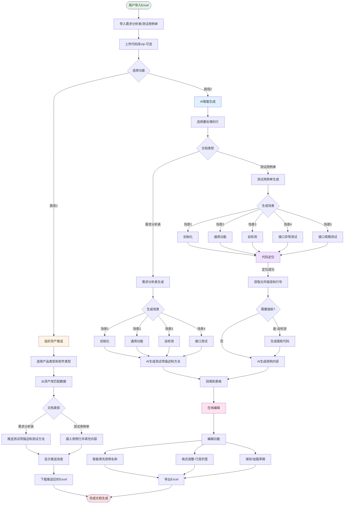
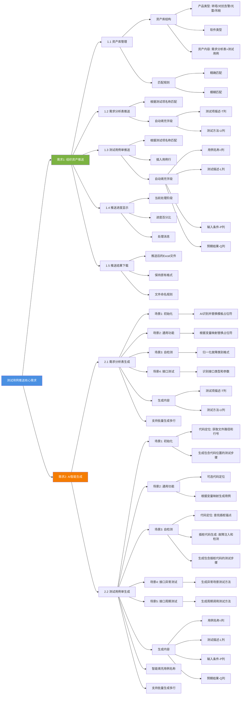

# 测试用例推送工具 - 用户需求文档

## 一、功能概述

测试用例推送工具是一个基于AI的智能测试文档生成系统，旨在帮助测试人员快速生成标准化的需求分析表和测试用例单，大幅提升测试文档编写效率。

### 用户需求总体流程图



**流程说明**：

1. **文件导入阶段**：导入需求分析表/测试用例单Excel → 可选上传代码库zip
2. **功能选择**：
   - **路径1 - 组织资产推送**：选择产品类型和软件类型 → 从资产库匹配历史数据 → 自动填充测试项描述/测试方法或插入用例行 → 显示进度 → 下载推送后的Excel
   - **路径2 - AI智能生成**：选择要处理的行 → 选择生成场景 → AI生成内容
3. **需求分析表生成**：4个场景（初始化/通用功能/自检测/接口测试）→ AI生成测试项描述和测试方法 → 回填到表格
4. **测试用例单生成**：5个场景 → 代码定位（获取文件路径和行号）→ 自检测场景生成插桩代码 → AI生成用例内容 → 回填到表格
5. **在线编辑**：智能填充用例名称 + 格式调整 + 草稿管理 → 导出Excel

### 核心用户需求思维导图



### 1.1 工具定位

本工具作为测试文档编写的辅助工具，解决以下核心痛点：
- **文档编写耗时**：手工编写需求分析表和测试用例单耗时耗力，效率低下
- **格式不统一**：不同测试人员编写的文档格式各异，难以标准化管理
- **内容质量参差**：缺乏经验的测试人员难以编写高质量的测试文档
- **资产复用困难**：历史项目的测试资产难以有效复用，重复劳动多

### 1.2 核心能力

**组织资产推送**：
- 从组织资产库中智能匹配历史测试数据
- 根据测试项名称自动填充需求分析表
- 根据测试项名称自动插入和填充测试用例
- 支持多种产品类型和软件类型的资产库

**AI智能生成**：
- 基于模板和上下文智能生成测试文档内容
- 支持需求分析表的4类生成场景
- 支持测试用例单的4类生成场景
- 自动定位代码位置，生成精确的测试步骤

**在线编辑**：
- 基于x-spreadsheet的在线Excel编辑器
- 支持导入/导出Excel文件
- 支持草稿保存和加载
- 支持右键菜单快捷操作

### 1.3 支持的文档类型

**需求分析表**：
- 包含测试项名称、需求子项描述、测试项描述、测试方法等字段
- 支持初始化、通用功能、自检测、接口测试等场景

**测试用例单**：
- 包含测试项名称、用例名称、测试描述、输入条件、预期结果等字段
- 支持初始化、通用功能、自检测、接口测试等场景

### 1.4 核心价值

- **效率提升80%**：通过AI自动生成和资产复用，大幅减少文档编写时间
- **质量保障**：基于标准模板和AI智能生成，确保文档质量和一致性
- **资产复用**：充分利用历史项目的测试资产，避免重复劳动
- **代码关联**：自动定位代码位置，生成精确的测试步骤和插桩代码

---

## 二、核心用户需求

### 需求1：组织资产推送，快速复用历史测试数据

**用户痛点**：
- 历史项目积累了大量测试文档，但难以有效复用
- 相似的测试项需要重复编写，浪费时间
- 不同项目的测试文档格式不统一，难以直接复用
- 缺乏统一的资产管理和推送机制

**解决方案**：通过组织资产库智能匹配和推送历史测试数据

#### 1.1 资产库管理

**需求描述**：
建立组织级的测试资产库，按产品类型和软件类型分类管理历史测试数据。

**资产库结构**：
- **产品类型**：转塔、对抗告警、光雷、吊舱等
- **软件类型**：每个产品类型下包含多个软件类型
- **资产内容**：
  - 需求分析表数据（测试项描述、测试方法）
  - 测试用例数据（用例名称、测试描述、输入条件、预期结果）

**数据来源**：
- 历史项目的测试文档
- 经过验证和标准化的测试数据
- 持续更新和维护

**实现方式**：
- 后端：`IntelligentExportService`智能导出服务
- 数据库：动态数据库管理模块
- 匹配规则：基于测试项名称的精确匹配或模糊匹配

**用户价值**：
- 充分利用历史测试资产
- 避免重复编写相同的测试内容
- 提升测试文档编写效率

#### 1.2 需求分析表推送

**需求描述**：
根据用户上传的需求分析表，从资产库中匹配测试项，自动填充测试项描述和测试方法。

**推送流程**：
1. 用户上传包含"需求分析表"sheet的Excel文件
2. 选择产品类型和软件类型
3. 系统从资产库中查询匹配的测试项数据
4. 根据测试项名称进行匹配：
   - 精确匹配：测试项名称完全相同
   - 模糊匹配：测试项名称包含关键词
5. 自动填充以下字段：
   - **测试项描述**（T列）：详细的测试项功能描述
   - **测试方法**（U列）：测试方法和步骤
6. 生成推送后的Excel文件供下载

**匹配规则**：
- 优先精确匹配：测试项名称完全一致
- 其次模糊匹配：测试项名称包含核心关键词
- 支持多对一匹配：一个测试项可能匹配多条资产数据

**实现方式**：
- 前端组件：`AssetReuseExportDialog.vue`
- 后端服务：`AssetReuseExportService`
- API接口：
  - `POST /asset-reuse-export/start`：启动推送任务
  - `GET /asset-reuse-export/progress/{task_id}`：查询推送进度
  - `GET /asset-reuse-export/download/{task_id}`：下载推送结果

**用户价值**：
- 快速填充需求分析表的核心字段
- 确保测试项描述和测试方法的标准化
- 减少手工编写时间

#### 1.3 测试用例单推送

**需求描述**：
根据用户上传的测试用例单，从资产库中匹配测试项，自动插入用例行并填充用例内容。

**推送流程**：
1. 用户上传包含"测试用例单"sheet的Excel文件
2. 选择产品类型和软件类型
3. 系统从资产库中查询匹配的测试用例数据
4. 根据测试项名称进行匹配
5. 在对应测试项下插入用例行
6. 自动填充以下字段：
   - **用例名称**（I列）：用例的简短名称
   - **测试描述**（L列）：详细的测试步骤描述
   - **输入条件**（P列）：测试的输入条件和前置条件
   - **预期结果**（Q列）：预期的测试结果
7. 生成推送后的Excel文件供下载

**插入策略**：
- 在测试项的第一行下方插入用例行
- 保持原有用例不变，新增用例追加在后面
- 自动调整行号和格式

**实现方式**：
- 前端组件：`AssetReuseExportDialog.vue`
- 后端服务：`AssetReuseExportService`
- 数据处理：`IntelligentExportService`

**用户价值**：
- 快速生成测试用例的基础框架
- 确保用例内容的完整性和标准化
- 大幅减少用例编写时间

#### 1.4 推送进度显示

**需求描述**：
实时显示资产推送的进度，让用户了解处理状态。

**进度信息**：
- 当前处理阶段：
  - 开始处理
  - 解析Excel文件
  - 匹配需求分析表数据
  - 匹配测试用例数据
  - 生成输出文件
  - 处理完成
- 进度百分比：0-100%
- 处理消息：当前正在执行的操作

**实现方式**：
- 前端：进度条组件（Element Plus Progress）
- 后端：通过回调函数更新进度
- 轮询机制：前端每秒查询一次进度

**用户价值**：
- 了解处理进度，避免焦虑等待
- 及时发现处理错误
- 提升用户体验

#### 1.5 推送结果下载

**需求描述**：
推送完成后，用户可以下载填充后的Excel文件。

**下载内容**：
- 原始Excel文件的所有sheet
- 需求分析表：已填充测试项描述和测试方法
- 测试用例单：已插入和填充用例行
- 保持原有格式和样式

**文件命名**：
- 格式：`[原文件名]_推送_[时间戳].xlsx`
- 示例：`测试文档_推送_20240101_120000.xlsx`

**实现方式**：
- 后端：生成Excel文件并存储到临时目录
- API：`GET /asset-reuse-export/download/{task_id}`
- 前端：点击下载按钮触发文件下载

**用户价值**：
- 获取完整的推送结果
- 可以在本地进一步编辑和完善
- 支持多次下载

---

### 需求2：AI智能生成测试文档，提升编写质量和效率

**用户痛点**：
- 从零开始编写测试文档耗时耗力
- 缺乏经验的测试人员难以编写高质量的测试内容
- 测试步骤描述不够详细和准确
- 难以定位代码位置和生成插桩代码

**解决方案**：通过AI智能生成测试文档内容，结合代码定位生成精确的测试步骤

#### 2.1 需求分析表生成

**需求描述**：
基于模板和上下文，使用AI智能生成需求分析表的测试项描述和测试方法。

**生成场景**：

**场景1：初始化**
- 适用：测试项名称包含"初始化"关键词
- 输入：
  - 测试项名称（如"SRIO初始化"）
  - 需求子项描述
  - 测试项描述模板（包含占位符xx、yy、zz等）
  - 测试方法模板
- AI任务：
  - 识别测试项中的关键对象（如SRIO）
  - 替换模板中的占位符
  - 生成完整的测试项描述和测试方法
- 输出：
  - 测试项描述：详细的功能描述
  - 测试方法：具体的测试步骤

**场景2：通用功能**
- 适用：常规功能测试项
- 输入：
  - 测试项名称
  - 需求子项描述
  - 当前测试项描述
  - 当前测试方法
  - 变量映射（xx、yy、zz等的具体值）
- AI任务：
  - 理解测试项的功能需求
  - 根据变量映射替换占位符
  - 优化和完善测试描述和方法
- 输出：
  - 优化后的测试项描述
  - 优化后的测试方法

**场景3：自检测**
- 适用：自检测相关的测试项
- 输入：
  - 测试项名称
  - 需求子项描述
  - 当前测试项描述
  - 当前测试方法
  - 变量映射
  - 故障类别（需要归一化）
- AI任务：
  - 归一化故障类别格式
  - 根据故障类别生成测试描述
  - 生成故障注入和检测的测试方法
- 输出：
  - 包含故障类别的测试项描述
  - 包含故障注入步骤的测试方法

**场景4：接口测试**
- 适用：接口相关的测试项
- 输入：
  - 测试项名称
  - 需求子项描述
  - 当前测试项描述
  - 当前测试方法
  - 变量映射
- AI任务：
  - 识别接口类型和参数
  - 生成接口测试的描述和方法
- 输出：
  - 接口测试的详细描述
  - 接口测试的具体步骤

**实现方式**：
- 后端服务：`RequirementDesignService`
- AI客户端：`ReqDesignAIClient`
- API接口：
  - `POST /req-design/init`：初始化场景
  - `POST /req-design/common`：通用功能场景
  - `POST /req-design/self-check`：自检测场景
  - `POST /req-design/api-test`：接口测试场景
- 前端功能：
  - `useReqDesignInit`：初始化生成
  - `useReqDesignCommon`：通用功能生成
  - `useReqDesignSelfCheck`：自检测生成
  - `useReqDesignApiTest`：接口测试生成

**用户价值**：
- 快速生成高质量的需求分析表内容
- 确保测试描述和方法的完整性
- 减少手工编写和思考时间

#### 2.2 测试用例单生成

**需求描述**：
基于模板、代码定位和上下文，使用AI智能生成测试用例单的用例内容。支持批量生成和智能填充功能。

**生成场景**：

**场景1：初始化**
- 适用：初始化相关的测试用例
- 输入：
  - 测试项名称
  - 用例名称模板
  - 测试描述模板
  - 输入条件模板
  - 预期结果模板
  - 代码片段（用于定位）
- AI任务：
  - **代码定位**：从代码片段中提取函数名和关键代码行，在代码库中搜索匹配，返回文件路径、行号和函数名
  - 识别初始化函数和变量
  - 替换模板中的占位符
  - 生成包含代码位置的精确测试步骤
- 输出：
  - 用例名称：如"SRIO初始化"
  - 测试描述：包含代码位置（文件路径+行号）和具体步骤
  - 输入条件：初始化的前置条件
  - 预期结果：初始化成功的标准

**场景2：通用功能**
- 适用：常规功能的测试用例
- 输入：
  - 测试项名称
  - 用例名称
  - 当前测试描述
  - 当前输入条件
  - 当前预期结果
  - 变量映射（xx、yy、zz等的具体值）
  - 代码片段（可选）
- AI任务：
  - 理解功能需求
  - 根据变量映射替换模板占位符
  - **代码定位**（可选）：如果提供代码片段，定位代码位置并生成包含位置信息的测试步骤
  - 生成详细的测试步骤
- 输出：
  - 优化后的用例名称
  - 详细的测试描述（可选包含代码位置）
  - 明确的输入条件
  - 明确的预期结果

**场景3：自检测**
- 适用：自检测相关的测试用例
- 输入：
  - 测试项名称
  - 用例名称
  - 当前测试描述
  - 当前输入条件
  - 当前预期结果
  - 变量映射
  - 故障类别
  - 代码片段（用于定位插桩位置）
- AI任务：
  - **代码定位**：定位代码文件和函数，查找插桩锚点（函数开始位置、关键变量赋值后、关键函数调用前后、返回语句前）
  - **插桩代码生成**：生成故障注入代码、故障检测代码和日志输出代码
  - 生成故障注入步骤
  - 生成故障检测步骤
- 输出：
  - 包含故障类别的用例名称
  - 详细的测试描述（包含插桩代码示例和位置）
  - 故障注入的输入条件
  - 故障检测的预期结果

**场景4：接口异常测试**
- 适用：接口异常处理的测试用例
- 输入：
  - 测试项名称
  - 用例名称
  - 当前测试描述
  - 当前输入条件
  - 当前预期结果
  - 变量映射
  - 代码片段（可选）
- AI任务：
  - 识别接口类型和参数
  - 生成异常场景的测试方法
  - 生成接口调用的测试步骤
- 输出：
  - 接口异常测试的用例名称
  - 详细的异常测试步骤
  - 异常输入条件
  - 异常处理的预期结果

**场景5：接口周期测试**
- 适用：接口周期性调用的测试用例
- 输入：
  - 测试项名称
  - 用例名称
  - 当前测试描述
  - 当前输入条件
  - 当前预期结果
  - 变量映射
  - 代码片段（可选）
- AI任务：
  - 识别接口类型和参数
  - 生成周期调用场景的测试方法
  - 生成接口调用的测试步骤
- 输出：
  - 接口周期测试的用例名称
  - 详细的周期测试步骤
  - 周期调用的输入条件
  - 周期调用的预期结果

**辅助功能**：

**智能填充用例名称**：
- 功能：从测试项名称（G列）自动复制到用例名称（I列）
- 使用场景：快速创建用例框架，确保用例名称与测试项名称一致
- 支持批量填充多行
- 保持原有内容不变（如果已有用例名称）

**批量生成**：
- 功能：支持批量选择多行，一次性生成多个用例的内容
- 流程：选择多行 → 右键选择生成功能 → 逐行处理 → 显示进度 → 批量回填结果
- 进度显示：当前处理第几行、总共多少行、成功/失败数量
- 错误处理：记录失败的行，继续处理其他行

**实现方式**：
- 后端服务：`CaseDesignService`
- AI客户端：`CaseDesignAIClient`
- 代码定位工具：`CodeLocator`
- API接口：
  - `POST /case-design/init`：初始化场景
  - `POST /case-design/common`：通用功能场景
  - `POST /case-design/self-check`：自检测场景
  - `POST /case-design/api-exception`：接口异常测试
  - `POST /case-design/api-period`：接口周期测试
  - `POST /case-fill/smart-fill`：智能填充用例名称
- 前端功能：
  - `useCaseDesignInit`：初始化生成
  - `useCaseDesignCommon`：通用功能生成
  - `useCaseDesignSelfCheck`：自检测生成
  - `useCaseDesignApiException`：接口异常测试生成
  - `useCaseDesignApiPeriod`：接口周期测试生成

**用户价值**：
- 快速生成高质量的测试用例
- 自动定位代码位置，生成精确的测试步骤
- 自动生成插桩代码，提升测试准确性
- 减少手工编写和代码查找时间

#### 2.3 代码定位功能

**需求描述**：
根据用户提供的代码片段，自动定位代码在项目中的位置（文件路径和行号），为生成精确的测试步骤提供支持。

**定位流程**：
1. 用户上传代码库压缩包（.zip）
2. 系统解压代码库到临时目录
3. 用户在生成测试用例时粘贴代码片段
4. 系统分析代码片段：
   - 提取函数名
   - 提取关键代码行
   - 识别代码特征
5. 在代码库中搜索匹配的代码：
   - 按函数名搜索
   - 按代码行精确匹配
   - 按代码模式模糊匹配
6. 返回定位结果：
   - 文件路径（相对路径）
   - 行号范围
   - 函数名
   - 上下文代码

**定位工具**：
- `locate_snippet_in_repo`：在代码库中定位代码片段
- `guess_function_name_from_snippet`：从代码片段中猜测函数名
- `extract_call_line_for_test_item`：提取测试项的调用行
- `find_enclosing_function_in_file`：在文件中查找包含指定行的函数
- `find_instrumentation_anchor_in_function`：在函数中查找插桩锚点

**实现方式**：
- 后端：`CodeLocator`工具类
- 代码库存储：`uploads/repos_extract/[session_id]/`
- 搜索算法：
  - 精确匹配：代码行完全一致
  - 模糊匹配：去除空格和注释后匹配
  - 函数名匹配：按函数名查找

**用户价值**：
- 无需手工查找代码位置
- 生成的测试步骤包含精确的代码位置
- 提升测试文档的准确性和可追溯性

#### 2.4 插桩代码生成

**需求描述**：
针对自检测场景，自动生成插桩代码，用于故障注入和检测。

**插桩流程**：
1. 定位代码文件和函数
2. 分析函数结构，找到插桩锚点：
   - 函数开始位置
   - 关键变量赋值后
   - 关键函数调用前后
   - 返回语句前
3. 生成插桩代码：
   - 故障注入代码
   - 故障检测代码
   - 日志输出代码
4. 将插桩代码嵌入测试描述中

**插桩示例**：
```c
// 原始代码
void init_srio() {
    srio_config_t config;
    config.baudrate = 9600;
    srio_init(&config);
}

// 插桩后
void init_srio() {
    srio_config_t config;
    config.baudrate = 9600;
    
    // 【插桩位置】故障注入
    if (fault_inject_enabled) {
        config.baudrate = 0; // 注入错误的波特率
    }
    
    srio_init(&config);
    
    // 【插桩位置】故障检测
    if (srio_status != SRIO_OK) {
        log_error("SRIO初始化失败");
    }
}
```

**实现方式**：
- 后端：`CaseDesignService`
- 插桩锚点查找：`find_instrumentation_anchor_in_function`
- AI生成：根据故障类别生成插桩代码

**用户价值**：
- 自动生成插桩代码，无需手工编写
- 确保插桩位置的准确性
- 提升自检测用例的质量

#### 2.5 模板占位符替换

**需求描述**：
支持在测试文档模板中使用占位符（xx、yy、zz、mm等），AI自动识别并替换为实际值。

**占位符类型**：
- **xx**：主要对象或变量（如SRIO、CAN、中断等）
- **yy**：次要对象或参数
- **zz**：第三个对象或参数
- **mm**：模块或功能名称
- **nn**、**kk**：其他占位符

**替换策略**：
1. **自动识别**：AI从测试项名称中提取关键词
   - 示例："SRIO初始化" → xx = "SRIO"
2. **用户指定**：用户通过变量映射指定占位符的值
   - 示例：`{"xx": "CAN", "yy": "波特率"}`
3. **智能替换**：AI根据上下文替换占位符
   - 保留模板结构
   - 替换占位符为实际值
   - 调整语句通顺性

**模板示例**：
```
测试项描述模板：
"验证xx初始化功能，包括yy配置和zz设置"

替换后：
"验证SRIO初始化功能，包括波特率配置和中断设置"
```

**实现方式**：
- 后端：`_apply_placeholders`方法
- AI识别：从测试项名称中提取关键词
- 正则替换：使用正则表达式替换占位符

**用户价值**：
- 提升模板的复用性
- 减少重复编写相似内容
- 确保文档的一致性

#### 2.6 批量生成

**需求描述**：
支持批量选择多行，一次性生成多个测试项或用例的内容。

**批量流程**：
1. 用户在表格中选择多行（Shift+点击或拖拽选择）
2. 点击右键菜单中的生成功能
3. 系统逐行处理：
   - 提取每行的数据
   - 调用AI生成内容
   - 回填生成结果到对应行
4. 显示处理进度：
   - 当前处理第几行
   - 总共多少行
   - 成功/失败数量
5. 完成后刷新表格显示

**进度显示**：
- Loading遮罩层
- 进度文本：`处理中（3/10）`
- 错误提示：失败的行数和原因

**实现方式**：
- 前端：循环调用API，逐行处理
- 后端：单行处理接口
- 错误处理：记录失败的行，继续处理其他行

**用户价值**：
- 大幅提升批量处理效率
- 减少重复操作
- 一次性完成多个测试项的生成

#### 2.7 智能填充

**需求描述**：
根据测试项名称，智能填充测试用例单的用例名称字段。

**填充规则**：
- 从测试项名称（G列）复制到用例名称（I列）
- 支持批量填充多行
- 保持原有内容不变（如果已有用例名称）

**使用场景**：
- 快速创建用例框架
- 确保用例名称与测试项名称一致
- 减少手工输入

**实现方式**：
- 前端：`useCaseSheetSmartFill`
- 操作：右键菜单 → 智能填充用例名称
- 批量处理：选择多行后一次性填充

**用户价值**：
- 快速填充用例名称
- 确保命名一致性
- 减少手工输入错误

---

## 三、技术实现架构

### 3.1 后端架构

**核心服务模块**：

**测试项服务**（`test_item_service/`）：
- `RequirementDesignService`：需求分析表生成服务
- `ReqDesignAIClient`：需求分析AI客户端
- `ReqDesignApiTestAIClient`：接口测试AI客户端
- `TestItemService`：测试项扩展服务

**测试用例服务**（`test_case_service/`）：
- `CaseDesignService`：测试用例生成服务
- `CaseDesignAIClient`：测试用例AI客户端
- `CaseFillService`：用例智能填充服务

**资产复用服务**（`assetReuseExport/`）：
- `AssetReuseExportService`：资产推送服务
- `IntelligentExportService`：智能导出服务（调用动态数据库管理模块）

**工具服务**（`tool/`）：
- `CodeLocator`：代码定位工具
  - `locate_snippet_in_repo`：定位代码片段
  - `guess_function_name_from_snippet`：猜测函数名
  - `extract_call_line_for_test_item`：提取调用行
  - `find_enclosing_function_in_file`：查找包含函数
  - `find_instrumentation_anchor_in_function`：查找插桩锚点

**Excel处理**：
- `ExcelProcessor`：Excel文件解析和生成

**数据库**：
- SQLite：`case_design.db`
- 表结构：
  - `CaseDesignRepo`：用例设计仓库表
  - `TestCaseReverseSession`：会话表
  - `TestItem`：测试项表
  - `GenerationLog`：生成日志表

**API端点**（`api/`）：
- `req_design_api.py`：需求分析表API
  - `POST /req-design/init`：初始化生成
  - `POST /req-design/common`：通用功能生成
  - `POST /req-design/self-check`：自检测生成
- `req_design_api_test_api.py`：接口测试API
  - `POST /req-design/api-test`：接口测试生成
- `case_design_api.py`：测试用例API
  - `POST /case-design/init`：初始化生成
  - `POST /case-design/common`：通用功能生成
  - `POST /case-design/self-check`：自检测生成
  - `POST /case-design/api-exception`：接口异常测试
  - `POST /case-design/api-period`：接口周期测试
- `case_fill_api.py`：用例填充API
  - `POST /case-fill/smart-fill`：智能填充
- `asset_reuse_selected_api.py`：资产选择API
- `assetReuseExport/api.py`：资产推送API
  - `POST /asset-reuse-export/start`：启动推送
  - `GET /asset-reuse-export/progress/{task_id}`：查询进度
  - `GET /asset-reuse-export/download/{task_id}`：下载结果

**AI能力**：
- 模型：OpenAI GPT系列
- 提示词管理：`prompts/`目录
- 上下文维护：会话级别的上下文管理
- 错误重试：支持最大重试次数配置

**文件存储**：
- 代码库存储：`uploads/repos_extract/[session_id]/`
- 代码库压缩包：`uploads/repos_zip/[session_id]/`
- 临时文件：`uploads/extra/`

### 3.2 前端架构

**主组件**：
- `TestCaseAssistant.vue`：主界面容器
  - 集成x-spreadsheet在线Excel编辑器
  - 管理工具栏和菜单
  - 协调各功能模块

**功能模块**（`features/`）：

**需求设计模块**（`reqDesign/`）：
- `useReqDesignInit.js`：初始化生成
- `useReqDesignCommon.js`：通用功能生成
- `useReqDesignSelfCheck.js`：自检测生成
- `useReqDesignApiTest.js`：接口测试生成

**用例设计模块**（`caseDesign/`）：
- `useCaseDesignInit.js`：初始化生成
- `useCaseDesignCommon.js`：通用功能生成
- `useCaseDesignSelfCheck.js`：自检测生成
- `useCaseDesignApiException.js`：接口异常测试
- `useCaseDesignApiPeriod.js`：接口周期测试
- `useCaseDesignIfReuseOther.js`：复用其他用例

**用例填充模块**（`caseFill/`）：
- `useCaseSheetSmartFill.js`：智能填充用例名称

**资产复用模块**（`assetReuse/`）：
- `useAssetReuseSelected.js`：资产选择逻辑
- `AssetReuseExportDialog.vue`：资产推送对话框
- `AssetReuseSelectedDialog.vue`：资产选择对话框

**扩展模块**（`reqExpand/`、`caseExpand/`）：
- `useTestItemExtend.js`：测试项扩展
- `useTestCaseExtend.js`：测试用例扩展

**通用功能**（`composables/`）：
- `useSpreadsheetIO.js`：Excel导入导出
- `useSpreadsheetFormat.js`：格式设置（行高、列宽）
- `useSpreadsheetDraft.js`：草稿保存和加载
- `useSpreadsheetContextMenu.js`：右键菜单管理

**组件**：
- `SpreadsheetContextMenu.vue`：右键菜单组件

**工具类**（`utils/`）：
- `xlsxAdapter.js`：Excel与x-spreadsheet数据格式转换
- `draftStore.js`：草稿本地存储管理

**技术栈**：
- Vue 3 + Composition API
- Element Plus UI组件库
- x-spreadsheet 在线Excel编辑器
- Axios HTTP客户端
- SheetJS (xlsx) Excel文件处理

### 3.3 数据流

**组织资产推送流程**：
1. 用户上传Excel文件和选择产品类型/软件类型
2. 前端发送文件到后端
3. 后端解析Excel，提取测试项列表
4. 调用`IntelligentExportService`查询资产库
5. 根据测试项名称匹配资产数据
6. 填充需求分析表和测试用例单
7. 生成新的Excel文件并缓存
8. 前端轮询进度，完成后下载文件

**AI生成流程**：
1. 用户在表格中选择行，右键选择生成功能
2. 前端提取选中行的数据
3. 如果需要代码定位，用户粘贴代码片段
4. 前端发送数据到后端API
5. 后端调用AI客户端生成内容
6. 如果有代码片段，调用CodeLocator定位代码
7. AI根据模板、上下文和代码位置生成内容
8. 后端返回生成结果
9. 前端回填结果到表格对应单元格
10. 刷新表格显示

**代码定位流程**：
1. 用户上传代码库zip文件
2. 后端解压到临时目录
3. 用户粘贴代码片段
4. 后端提取函数名和关键代码行
5. 在代码库中搜索匹配的代码
6. 返回文件路径、行号、函数名
7. AI使用定位结果生成测试步骤

**进度同步**：
- 资产推送：后端通过回调函数更新进度，前端轮询查询
- AI生成：前端显示Loading遮罩，后端同步返回结果
- 批量处理：前端逐行调用API，实时更新进度文本

### 3.4 关键技术点

**x-spreadsheet集成**：
- 在线Excel编辑器，支持公式、样式、合并单元格等
- 数据格式转换：Excel ↔ x-spreadsheet JSON格式
- 右键菜单扩展：自定义菜单项，触发AI生成功能
- 单元格操作：读取、写入、格式化

**Excel文件处理**：
- 导入：使用SheetJS解析Excel文件
- 导出：使用SheetJS生成Excel文件
- 格式保持：保留原有样式、合并单元格、列宽等
- 多Sheet支持：需求分析表和测试用例单

**AI提示词工程**：
- 模板化提示词：预定义提示词模板
- 上下文注入：动态注入测试项信息、代码片段等
- 占位符替换：识别和替换xx、yy、zz等占位符
- 结果解析：解析AI返回的JSON格式结果

**代码定位算法**：
- 函数名匹配：提取函数名，在代码库中搜索
- 代码行匹配：精确匹配代码行内容
- 模糊匹配：去除空格和注释后匹配
- 上下文验证：验证匹配结果的上下文是否一致

**插桩锚点查找**：
- 函数结构分析：识别函数开始、结束、返回语句
- 关键位置识别：变量赋值、函数调用、条件判断
- 锚点选择：选择最合适的插桩位置
- 代码生成：生成插桩代码示例

**草稿管理**：
- 本地存储：使用localStorage保存草稿
- 自动保存：可选的自动保存功能
- 版本管理：支持多个草稿版本
- 恢复机制：意外关闭后可恢复草稿

**错误处理**：
- API错误：统一的错误提示和日志记录
- AI生成失败：记录失败原因，支持重试
- 代码定位失败：提示用户检查代码片段或代码库
- 文件处理错误：提示用户检查文件格式

---

## 四、用户使用流程

### 4.1 组织资产推送流程

#### 步骤1：准备文件

**需要准备的文件**：
- **Excel文件**（.xlsx或.xls格式）
  - 必须包含"需求分析表"sheet
  - 必须包含"测试用例单"sheet
  - 需求分析表包含测试项名称列（O列）
  - 测试用例单包含测试项名称列（G列）

#### 步骤2：打开资产推送对话框

1. 访问测试用例推送工具页面
2. 点击工具栏上的"组织资产复用"按钮
3. 弹出"组织资产复用"对话框

#### 步骤3：选择产品类型和软件类型

1. **选择产品类型**：
   - 转塔
   - 对抗告警
   - 光雷
   - 吊舱

2. **选择软件类型**：
   - 根据产品类型，系统自动加载可用的软件类型列表
   - 从下拉列表中选择对应的软件类型

#### 步骤4：上传Excel文件

1. 点击"选择文件"按钮
2. 选择准备好的Excel文件
3. 系统显示文件名和大小

#### 步骤5：开始处理

1. 确认产品类型、软件类型和文件都已选择
2. 点击"开始处理"按钮
3. 系统开始处理：
   - 解析Excel文件
   - 匹配需求分析表数据
   - 匹配测试用例数据
   - 生成输出文件

#### 步骤6：查看进度

**进度显示**：
- 进度条：显示0-100%的处理进度
- 进度文本：显示当前处理阶段
- 进度百分比：显示具体的百分比数值

**处理阶段**：
1. 开始处理（0%）
2. 解析Excel文件（20%）
3. 匹配需求分析表数据（40%）
4. 匹配测试用例数据（60%）
5. 生成输出文件（80%）
6. 处理完成（100%）

#### 步骤7：下载结果

1. 处理完成后，"开始处理"按钮变为"下载文件"按钮
2. 点击"下载文件"按钮
3. 浏览器自动下载填充后的Excel文件
4. 文件命名格式：`[原文件名]_推送_[时间戳].xlsx`

#### 步骤8：查看推送结果

1. 打开下载的Excel文件
2. 查看"需求分析表"sheet：
   - 测试项描述（T列）已填充
   - 测试方法（U列）已填充
3. 查看"测试用例单"sheet：
   - 已插入新的用例行
   - 用例名称（I列）已填充
   - 测试描述（L列）已填充
   - 输入条件（P列）已填充
   - 预期结果（Q列）已填充

---

### 4.2 AI生成需求分析表流程

#### 步骤1：导入Excel文件

1. 点击工具栏上的"导入 .xlsx"按钮
2. 选择包含需求分析表的Excel文件
3. 系统加载文件到在线编辑器
4. 切换到"需求分析表"sheet

#### 步骤2：上传代码库（可选）

**如果需要代码定位功能**：
1. 点击工具栏上的"上传代码库 .zip"按钮
2. 选择代码库压缩包
3. 系统上传并解压代码库
4. 显示上传成功提示

#### 步骤3：选择要处理的行

1. 在表格中选择要生成内容的行：
   - 单行：直接点击行号
   - 多行：按住Shift键点击起始行和结束行
   - 或者拖拽鼠标选择多行

#### 步骤4：选择生成场景

**右键点击选中的行，选择对应的生成功能**：

**场景1：需求设计-初始化**
- 适用：测试项名称包含"初始化"
- 操作：右键 → 需求设计 → 初始化
- 系统自动：
  - 提取测试项名称、需求子项描述、模板内容
  - 调用AI生成测试项描述和测试方法
  - 回填到T列和U列

**场景2：需求设计-通用功能**
- 适用：常规功能测试项
- 操作：右键 → 需求设计 → 通用功能
- 弹出对话框：
  - 输入变量映射（xx、yy、zz等的值）
  - 示例：`xx=SRIO, yy=波特率`
- 点击确定，系统生成并回填

**场景3：需求设计-自检测**
- 适用：自检测相关测试项
- 操作：右键 → 需求设计 → 自检测
- 弹出对话框：
  - 输入变量映射
  - 输入故障类别（如"通信故障"）
- 点击确定，系统生成并回填

**场景4：需求设计-接口测试**
- 适用：接口相关测试项
- 操作：右键 → 需求设计 → 接口测试
- 弹出对话框：
  - 输入变量映射
  - 输入接口相关信息
- 点击确定，系统生成并回填

#### 步骤5：查看生成结果

1. 系统显示处理进度（如"处理中（3/10）"）
2. 处理完成后，表格自动刷新
3. 查看生成的内容：
   - T列：测试项描述
   - U列：测试方法
4. 如有需要，可以手工调整生成的内容

#### 步骤6：保存和导出

1. **保存草稿**（可选）：
   - 点击"保存草稿"按钮
   - 草稿保存到浏览器本地存储
   - 下次打开可以加载草稿继续编辑

2. **导出Excel**：
   - 在"文件名"输入框中输入文件名
   - 点击"导出 .xlsx"按钮
   - 浏览器自动下载Excel文件

---

### 4.3 AI生成测试用例单流程

#### 步骤1：导入Excel文件

1. 点击工具栏上的"导入 .xlsx"按钮
2. 选择包含测试用例单的Excel文件
3. 系统加载文件到在线编辑器
4. 切换到"测试用例单"sheet

#### 步骤2：上传代码库（必需）

**测试用例生成需要代码定位功能**：
1. 点击工具栏上的"上传代码库 .zip"按钮
2. 选择代码库压缩包
3. 系统上传并解压代码库
4. 显示上传成功提示

#### 步骤3：选择要处理的行

1. 在表格中选择要生成用例的行
2. 支持单行或多行选择

#### 步骤4：选择生成场景

**右键点击选中的行，选择对应的生成功能**：

**场景1：用例设计-初始化**
- 适用：初始化相关用例
- 操作：右键 → 用例设计 → 初始化
- 弹出对话框：
  - 粘贴入口函数中的初始化代码片段
  - 示例：main函数中的SRIO初始化代码
- 点击确定，系统：
  - 定位代码位置（文件路径和行号）
  - 生成用例名称、测试描述、输入条件、预期结果
  - 回填到I、L、P、Q列

**场景2：用例设计-通用功能**
- 适用：常规功能用例
- 操作：右键 → 用例设计 → 通用功能
- 弹出对话框：
  - 输入变量映射
  - 可选：粘贴相关代码片段
- 点击确定，系统生成并回填

**场景3：用例设计-自检测**
- 适用：自检测用例
- 操作：右键 → 用例设计 → 自检测
- 弹出对话框：
  - 输入变量映射
  - 输入故障类别
  - 粘贴相关代码片段（用于定位插桩位置）
- 点击确定，系统：
  - 定位代码位置
  - 查找插桩锚点
  - 生成插桩代码
  - 生成用例内容（包含插桩代码）
  - 回填到表格

**场景4：用例设计-接口异常测试**
- 适用：接口异常场景
- 操作：右键 → 用例设计 → 接口异常测试
- 弹出对话框：
  - 输入变量映射
  - 输入接口信息
  - 可选：粘贴代码片段
- 点击确定，系统生成并回填

**场景5：用例设计-接口周期测试**
- 适用：接口周期调用场景
- 操作：右键 → 用例设计 → 接口周期测试
- 弹出对话框：
  - 输入变量映射
  - 输入周期信息
  - 可选：粘贴代码片段
- 点击确定，系统生成并回填

#### 步骤5：智能填充用例名称（可选）

**快速填充用例名称**：
1. 选择要填充的用例行
2. 右键 → 智能填充用例名称
3. 系统自动将测试项名称（G列）复制到用例名称（I列）

#### 步骤6：查看生成结果

1. 系统显示处理进度
2. 处理完成后，表格自动刷新
3. 查看生成的内容：
   - I列：用例名称
   - L列：测试描述（包含代码位置和步骤）
   - P列：输入条件
   - Q列：预期结果
4. 特别关注测试描述中的：
   - 代码文件路径和行号
   - 插桩代码（自检测场景）
   - 具体的测试步骤

#### 步骤7：保存和导出

1. **保存草稿**（可选）：
   - 点击"保存草稿"按钮
   - 草稿保存到浏览器本地存储

2. **导出Excel**：
   - 输入文件名
   - 点击"导出 .xlsx"按钮
   - 下载Excel文件

---

### 4.4 高级使用场景

#### 场景1：批量生成多个测试项

**使用场景**：
- 需要为多个测试项生成内容
- 测试项类型相同（如都是初始化）

**操作步骤**：
1. 选择多行（Shift+点击或拖拽）
2. 右键选择对应的生成功能
3. 系统逐行处理，显示进度
4. 完成后一次性回填所有结果

**注意事项**：
- 批量生成时间较长，请耐心等待
- 如果某行生成失败，系统会跳过并继续处理其他行
- 完成后会提示成功和失败的数量

#### 场景2：复用其他用例

**使用场景**：
- 当前用例与其他用例类似
- 希望复用其他用例的内容

**操作步骤**：
1. 选择要填充的用例行
2. 右键 → 用例设计 → 复用其他用例
3. 弹出用例选择对话框
4. 浏览和搜索可复用的用例
5. 选择要复用的用例
6. 点击确定，系统将选中用例的内容复制到当前行

#### 场景3：格式调整

**调整行高**：
1. 选择要调整的行
2. 点击工具栏"格式"→"行高"
3. 输入行高值（如30）
4. 点击确定

**调整列宽**：
1. 选择要调整的列
2. 点击工具栏"格式"→"列宽"
3. 输入列宽值（如150）
4. 点击确定

#### 场景4：草稿管理

**保存草稿**：
- 点击"保存草稿"按钮
- 草稿自动保存到浏览器本地存储
- 支持保存多个草稿版本

**加载草稿**：
- 点击"加载草稿"按钮
- 选择要加载的草稿版本
- 系统恢复草稿内容到编辑器

**使用场景**：
- 编辑过程中临时保存
- 意外关闭浏览器后恢复
- 在不同草稿版本间切换

#### 场景5：多次迭代优化

**使用场景**：
- 首次生成的内容不够满意
- 需要调整变量映射或代码片段

**操作步骤**：
1. 查看首次生成的内容
2. 分析不满意的地方
3. 调整输入：
   - 修改变量映射
   - 更换代码片段
   - 调整模板内容
4. 重新执行生成功能
5. 对比新旧结果，选择更好的版本

---

### 4.5 常见问题处理

#### 问题1：AI生成失败

**可能原因**：
- 网络连接问题
- AI服务暂时不可用
- 输入数据格式错误

**解决方法**：
- 检查网络连接
- 稍后重试
- 检查输入数据是否完整
- 查看后端日志获取详细错误信息

#### 问题2：代码定位失败

**可能原因**：
- 代码库未上传
- 代码片段不完整或不准确
- 代码库中不存在该代码

**解决方法**：
- 确认已上传代码库
- 检查代码片段是否完整
- 尝试粘贴更多的上下文代码
- 确认代码片段来自上传的代码库

#### 问题3：生成内容不符合预期

**可能原因**：
- 变量映射不准确
- 模板内容不合适
- AI理解偏差

**解决方法**：
- 调整变量映射，使用更准确的值
- 修改模板内容，提供更多上下文
- 重新生成，多次尝试
- 手工调整生成的内容

#### 问题4：Excel导入导出失败

**可能原因**：
- 文件格式不正确
- 文件损坏
- 浏览器兼容性问题

**解决方法**：
- 确认文件格式为.xlsx或.xls
- 尝试用Excel重新保存文件
- 更换浏览器（推荐Chrome或Edge）
- 检查文件大小是否过大

#### 问题5：草稿保存失败

**可能原因**：
- 浏览器本地存储已满
- 浏览器隐私模式
- 浏览器不支持localStorage

**解决方法**：
- 清理浏览器缓存和本地存储
- 退出隐私模式
- 更换浏览器
- 定期导出Excel文件作为备份

